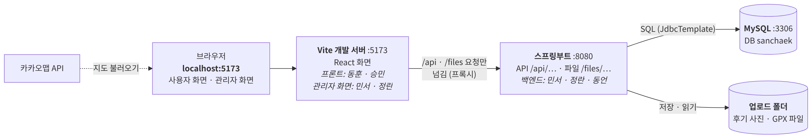
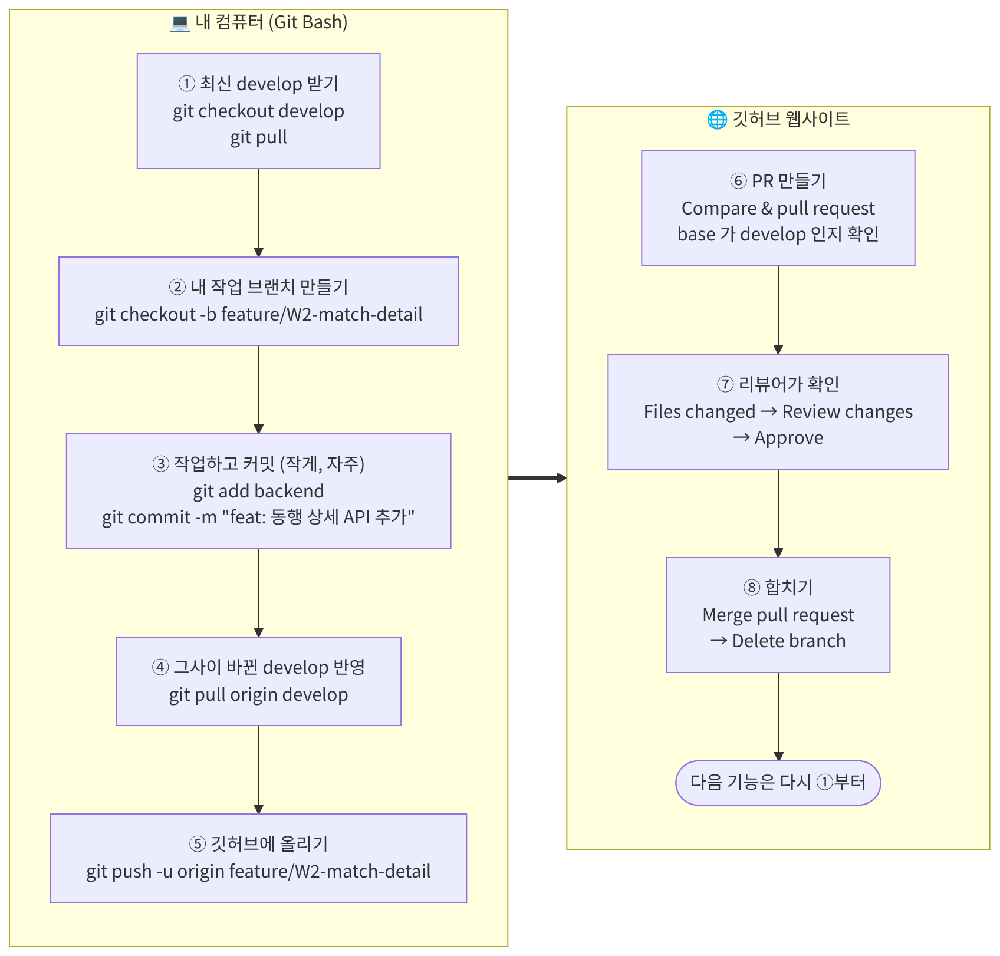

# 🚶 산책시루 (Team_walk)

7팀 **산책크루**의 시흥시 정왕동 산책 동행 서비스 저장소입니다.

> [!WARNING]
> **백엔드를 JSP · Servlet에서 스프링부트로 바꾸는 중입니다.**<br>
> 지금 `backend` 폴더의 Servlet 코드와 세팅 가이드의 이클립스 · Tomcat 부분은 곧 바뀝니다.
>
> **그 전까지 지금 해도 되는 것**
> - Git · JDK 21 · Node.js · VS Code 설치와 저장소 받기 → [세팅 가이드](docs/setup.md) 1 · 2번 (Tomcat · 이클립스는 건너뛰기)
> - 프론트 세팅 → [세팅 가이드 4번](docs/setup.md#4-프론트-세팅-처음-한-번)
> - MySQL 설치와 DB 세팅 → [DB 안내 1) ~ 4)](db/README.md#처음-세팅-윈도우-한-번만)

<br>

## 목차

1. [한눈에 보기](#-한눈에-보기)
2. [기술 스택](#-기술-스택)
3. [누가 뭘 하나](#-누가-뭘-하나)
4. [문서 안내](#-문서-안내)
5. [빠른 시작](#-빠른-시작)
6. [깃허브로 작업하는 법](#-깃허브로-작업하는-법)
7. [폴더 구조](#-폴더-구조)
8. [꼭 지킬 것](#-꼭-지킬-것)

<br>

## 📌 한눈에 보기



- 브라우저는 항상 **`localhost:5173`** 으로 접속합니다.<br>
  사용자 화면과 관리자 화면 모두 React입니다.

- `/api/…`, `/files/…` 요청만 Vite가 **스프링부트(`8080`)** 로 넘깁니다.

- 스프링부트는 각자 PC의 **MySQL(`3306`)** 에 있는 `sanchaek` DB를 씁니다.

- **배포는 하지 않습니다.**<br>
  시연은 노트북 한 대에 DB · 백엔드 · 프론트를 모두 띄워서 합니다.

<br>

## 🧰 기술 스택

| 항목 | 사용 |
| --- | --- |
| 프론트 | React 19 + Vite 8, ESLint |
| 백엔드 | 스프링부트 4.1, Gradle |
| Java | JDK 21 |
| Node.js | 22.12 이상 (LTS) |
| DB | MySQL 8.4 (8.0도 가능), 각자 PC에 설치 |
| DB 접근 | JdbcTemplate (SQL을 직접 작성) |
| 개발 도구 | VS Code (프론트는 WebStorm도 가능) |
| 지도 | 카카오맵 JavaScript API |
| 협업 | GitHub |
| 배포 | 하지 않음 (로컬 시연) |

> [!TIP]
> 인터넷 예제가 `import javax.…` 로 시작하면 옛날 버전(스프링부트 2) 예제입니다.<br>
> `jakarta.…` 로 바꾸거나, 스프링부트 3 이상 예제를 찾아보세요.

<br>

## 👥 누가 뭘 하나

| 이름 | 역할 | 맡은 기능 |
| --- | --- | --- |
| 민서 | 백엔드 · 팀장 | 동행, 공통 코드, 관리자 AD3 |
| 정란 | 백엔드 | 계정, 신고, 관리자 AD1 · AD2 · AD4 |
| 동언 | 백엔드 | 코스 · GPX, 후기, 랜드마크 · 스탬프 |
| 동훈 | 프론트 | 지도 · 코스 · 동행 화면 |
| 승민 | 프론트 | 계정 · 마이페이지 · 후기 · 스탬프 · 신고 화면, 에러 페이지, 공통 부품 |

- 관리자 화면(AD1~AD4)은 **백엔드 담당이 React로 직접** 만듭니다.
- 화면별 분배와 일정은 **팀 노션**에 있습니다.

<br>

## 📚 문서 안내

| 문서 | 언제 보나 | 내용 |
| --- | --- | --- |
| [세팅 가이드](docs/setup.md) | 처음 한 번 | 설치, 저장소 받기, 프론트 세팅 |
| [DB 안내](db/README.md) | DB 세팅할 때<br>테이블이 바뀔 때 | ERD, 설계 약속, 테스트 계정, 쿼리 예시 |
| [개발 규칙](docs/development.md) | 작업할 때마다 | 화면 · API 만드는 법, **깃허브 사용법**, 커밋 메시지 |
| [막혔을 때](docs/troubleshooting.md) | 오류가 났을 때 | 지금까지 겪은 문제와 해결법 |

**저장소 밖 문서**

- 🗒 **노션** — 역할 분배, 우선순위(1순위 · 2순위 · 보류), 일정
- 🎨 **[Figma](https://www.figma.com/design/8g73YEapksdegpYXV7aPKp)** — 화면 설계, 화면 ID(A1, C1, W2 …), 📝 메모
- 📄 **API 명세** — 주소, 요청 · 응답 예시, 담당자 (노션의 "API 명세" 링크)

<br>

## ✅ 빠른 시작

스프링부트 전환이 끝나면 아래 세 가지가 모두 보여야 합니다.<br>
다 되면 화면을 캡처해서 팀에 공유해 주세요.

**1. 백엔드** — `http://localhost:8080/api/hello`

```json
{"success":true,"data":{"message":"안녕하세요, 산책시루 서버입니다", …}}
```

**2. 프론트** — `http://localhost:5173/`

> 산책시루 프론트가 동작합니다<br>
> ✅ 연결 성공

**3. DB** — `mysql>` 에서 `source …/db/check.sql`

> 7줄 모두 **OK** ([DB 안내 4)](db/README.md#4-확인))

<br>

## 🌿 깃허브로 작업하는 법

**기능 하나 = 브랜치 하나 = PR 하나**

main · develop에는 직접 올리지 않습니다.<br>
항상 **내 브랜치 → PR → 리뷰 → 합치기** 순서입니다.



```bash
# ① 최신 develop 받기
git checkout develop
git pull

# ② 내 브랜치 만들기 (feature/화면ID-기능)
git checkout -b feature/W2-match-detail

# ③ 작업하고 커밋 (작게, 자주)
git add backend
git commit -m "feat: 동행 상세 API 추가"

# ④ 그사이 바뀐 develop 반영
git pull origin develop

# ⑤ 깃허브에 올리기 → 깃허브 화면에서 PR 만들기 (base: develop)
git push -u origin feature/W2-match-detail
```

**처음이라면 여기를 보세요**

| 상황 | 자세히 |
| --- | --- |
| 이름 · 이메일 설정 (처음 한 번) | [3-1. 처음 한 번](docs/development.md#3-1-처음-한-번) |
| PR 만드는 화면, 리뷰어 지정 | [3-3. PR 올리는 법](docs/development.md#3-3-pr-올리는-법-깃허브-화면) |
| 리뷰어가 할 일<br>(Approve → Merge → Delete branch) | [3-4. 리뷰하고 합치는 법](docs/development.md#3-4-리뷰하고-합치는-법-리뷰어) |
| `CONFLICT`가 났다 | [3-5. 충돌이 났을 때](docs/development.md#3-5-충돌이-났을-때) |
| develop에서 바로 작업했다<br>커밋 메시지를 틀렸다 등 | [3-6. 자주 하는 실수와 되돌리기](docs/development.md#3-6-자주-하는-실수와-되돌리기) |

<br>

## 🗂 폴더 구조

```
Team_walk/
├─ README.md                지금 보는 안내판
├─ docs/                    문서
│  ├─ setup.md              세팅 가이드
│  ├─ development.md        개발 규칙 · 깃허브 사용법
│  ├─ troubleshooting.md    막혔을 때
│  └─ images/               README 그림 (.png) 과 원본 (.mmd)
│
├─ db/                      DB (민서 관리, 바꿀 때는 PR)
│  ├─ README.md             ERD, 설계 약속, MySQL 세팅, 테스트 계정
│  ├─ schema.sql            테이블 만들기 (실행하면 데이터 초기화)
│  ├─ seed.sql              테스트 데이터
│  ├─ check.sql             세팅 확인 (7줄 모두 OK면 성공)
│  └─ sample-uploads/       테스트용 후기 사진
│
├─ backend/                 백엔드 (VS Code로 열기) — 스프링부트로 교체 예정
│  ├─ build.gradle          라이브러리 목록 (예정)
│  └─ src/main/
│     ├─ java/kr/sanchaek/
│     │  ├─ common/         공통 코드 (민서) · ★ /api/hello 테스트 API
│     │  ├─ match/          동행 (민서)
│     │  ├─ user/           계정 · 신고 · 관리자 (정란)
│     │  └─ course/         코스 · GPX · 후기 · 랜드마크 (동언)
│     └─ resources/         설정 파일 (DB 비밀번호는 각자 PC에만)
│
└─ frontend/                프론트 (VS Code · WebStorm으로 열기)
   ├─ package.json          라이브러리 목록
   ├─ vite.config.js        개발 서버 설정, /api · /files 프록시
   └─ src/
      ├─ main.jsx           React 시작점
      ├─ App.jsx            ★ 환경 확인용 테스트 화면
      ├─ pages/             (예정) 화면 하나 = 파일 하나, Figma 화면 ID로 이름
      │  └─ admin/          (예정) 관리자 화면 AD1~AD4 (백엔드 담당이 만듦)
      ├─ components/        (예정) 공통 부품 (버튼, 헤더, 카드, 지도 …)
      ├─ api/               (예정) 백엔드 호출 함수
      └─ mocks/             (예정) 백엔드 완성 전 가짜 데이터
```

- **★ 표시는 환경 확인용 테스트 코드입니다. 지우지 마세요.**
- **자기 담당 폴더에서만 작업**하면 충돌이 거의 생기지 않습니다.

<br>

## 🚨 꼭 지킬 것

**🔒 비밀번호 · API 키는 절대 커밋하지 않기**

- DB 비밀번호는 각자 PC의 설정 파일에만 넣습니다 (깃허브에 안 올라가는 파일).
- 카카오 키처럼 같이 써야 하는 키는 커밋하지 말고 팀원에게 따로 전달합니다.
- 한 번이라도 커밋되면 기록에 남아서, 키를 새로 발급받아야 합니다.

**🚫 main · develop에 직접 push 하지 않기**

- 항상 내 브랜치 → PR ([브랜치 · PR 규칙](docs/development.md#2-브랜치pr-규칙))

**📣 같이 쓰는 파일은 고치기 전에 팀에 먼저 알리기**

- `db/schema.sql`, `backend/build.gradle`, `frontend/package.json`, 프론트 라우터

**🔄 작업 시작 전에 항상 `git pull`**

**⭐ 환경 확인용 테스트 코드(★) 지우지 않기**
