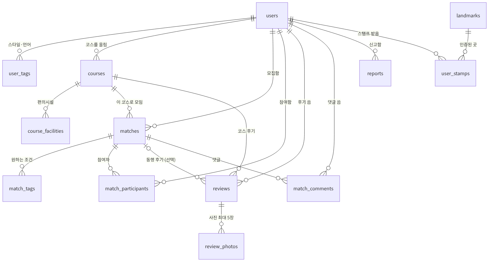
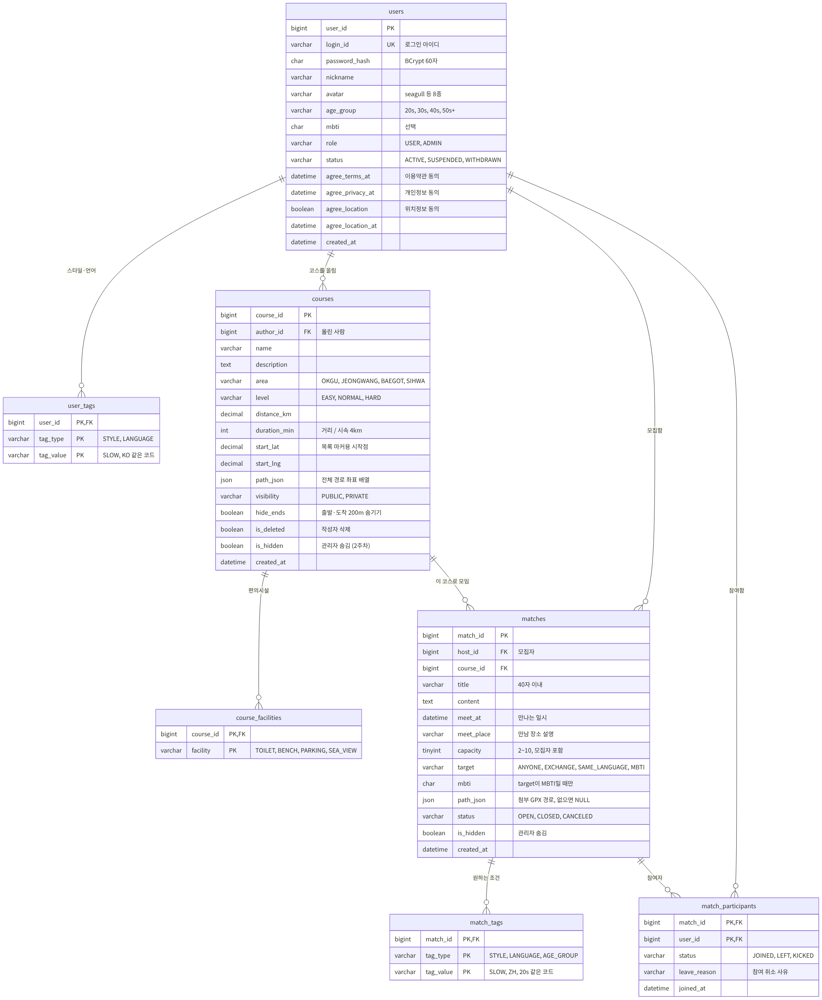
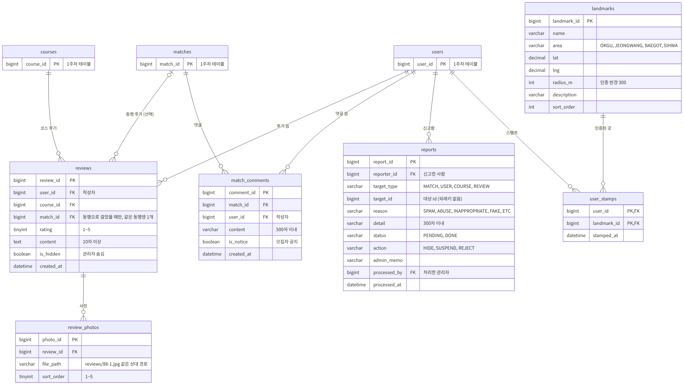
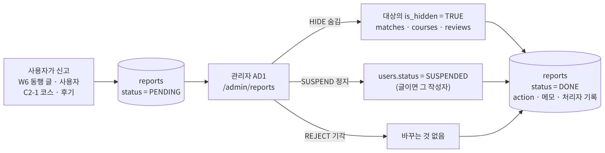
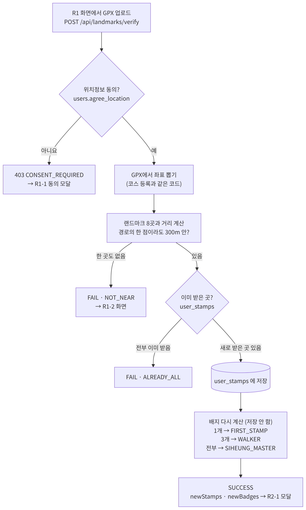

# DB 안내 (MySQL)

[← README](../README.md) · [세팅 가이드](../docs/setup.md) · [개발 규칙](../docs/development.md) · [막혔을 때](../docs/troubleshooting.md)

1주차(계정 · 코스 · 동행) **테이블 7개**, 2주차(후기 · 신고 · 랜드마크 · 스탬프 · 댓글) **테이블 6개**, 계산용 **뷰 2개**가 있습니다.
DB는 **각자 PC의 MySQL**을 씁니다. 배포 서버는 아직 계획이 없습니다.

| 파일 | 내용 |
| --- | --- |
| `schema.sql` | 테이블 만들기. **실행하면 기존 테이블과 데이터가 전부 지워지고 새로 만들어집니다** |
| `seed.sql` | 테스트 데이터 (회원 7명, 코스 4개, 동행 6개, 랜드마크 8곳, 후기 6개, 신고 3개 …). `schema.sql` 다음에 실행 |
| `check.sql` | 세팅 확인. 7줄 모두 `OK`면 성공 |
| `sample-uploads/` | 테스트 데이터의 후기 사진 2장. 각자 PC의 업로드 폴더로 복사해서 씁니다 ([5)](#5-후기-사진-폴더-만들기-2주차)) |

## 목차

- [ERD (테이블 관계도)](#erd-테이블-관계도)
- [테이블 한눈에 보기](#테이블-한눈에-보기)
- [설계 약속 (꼭 읽기)](#설계-약속-꼭-읽기)
- [처음 세팅 (윈도우, 한 번만)](#처음-세팅-윈도우-한-번만)
- [테스트 계정과 샘플 데이터](#테스트-계정과-샘플-데이터)
- [쿼리 예시](#쿼리-예시)
- [테이블을 바꾸고 싶을 때](#테이블을-바꾸고-싶을-때)
- [막혔을 때](#막혔을-때)
- [부록: 맥](#부록-맥)

---

## ERD (테이블 관계도)

깃허브에서 **그림을 누르면 크게** 볼 수 있습니다.

### 전체 (테이블 13개)



- **선 읽는 법:** `||` 쪽이 1, `o{` 쪽이 0개 이상(N). 예) 회원 1명이 코스를 0개 이상 올림 (1 : N)
- `reports`(신고)는 동행 글 · 사용자 · 코스 · 후기를 모두 가리킬 수 있어서 선 대신 `target_type` + `target_id`로 연결합니다 → [설계 약속 10](#10-신고와-관리자-처리-2주차)
- 그림에 없는 것: 뷰 2개 (`v_match_status` 동행 상태, `v_course_rating` 코스 별점)

### 1주차 상세 (계정 · 코스 · 동행)



### 2주차 상세 (후기 · 신고 · 랜드마크 · 스탬프 · 댓글)



- 위쪽의 `users`, `courses`, `matches`는 1주차 테이블이라 id만 그렸습니다.
- 모든 테이블에 `created_at`이 있고, 고칠 수 있는 테이블에는 `updated_at`도 있습니다 (그림에서는 일부 생략).
- 그림 원본은 [`docs/images/`](../docs/images/)의 `.mmd` 파일입니다. 테이블이 바뀌면 원본을 고치고 [mermaid.live](https://mermaid.live)에 붙여 넣어 PNG로 다시 저장합니다 (민서).

---

## 테이블 한눈에 보기

**1주차**

| 테이블 | 담당 | 한 줄에 담기는 것 | 메모 |
| --- | --- | --- | --- |
| `users` | 정란 | 회원 1명 | 탈퇴해도 지우지 않음 (`status = 'WITHDRAWN'`) |
| `user_tags` | 정란 | 회원의 스타일 또는 언어 1개 | 언어가 2개면 2줄 |
| `courses` | 동언 | 코스 1개 | 경로는 `path_json` 한 칸에 통째로 |
| `course_facilities` | 동언 | 코스의 편의시설 1개 | 있음/없음만 (개수 없음) |
| `matches` | 민서 | 동행 모집 글 1개 | `status`에는 OPEN · CLOSED · CANCELED만 저장 |
| `match_tags` | 민서 | 동행이 원하는 스타일 · 언어 · 연령대 1개 | |
| `match_participants` | 민서 | 동행 참여자 1명 | 모집자도 한 줄 들어감 |

**2주차**

| 테이블 | 담당 | 한 줄에 담기는 것 | 메모 |
| --- | --- | --- | --- |
| `reviews` | 정란 | 후기 1개 | 같은 동행에는 1개만. 작성자가 지우면 실제로 삭제 |
| `review_photos` | 정란 | 후기 사진 1장 | 파일은 업로드 폴더에, DB에는 상대 경로만 |
| `reports` | 정란 | 신고 1건 | 대상은 `target_type` + `target_id`. 관리자 AD1에서 처리 |
| `landmarks` | 동언 | 랜드마크 1곳 | 8곳을 `seed.sql`로 미리 넣음 (관리자 화면 없음) |
| `user_stamps` | 동언 | 회원이 받은 스탬프 1개 | 랜드마크마다 1번만. 배지는 저장 안 하고 계산 |
| `match_comments` | 민서 | 동행 댓글 1개 | 모집자 공지는 `is_notice = TRUE` |

**뷰 (저장하지 않고 계산하는 표)**

| 뷰 | 담당 | 내용 |
| --- | --- | --- |
| `v_match_status` | 민서 | 동행 1개의 현재 인원 · 화면 상태 (FULL, DONE은 여기서 계산) |
| `v_course_rating` | 정란 · 동언 | 코스 1개의 후기 수 · 평균 별점 (관리자가 숨긴 후기는 뺌) |

---

## 설계 약속 (꼭 읽기)

### 1. 이름과 값

- **DB는 `snake_case`, JSON은 `camelCase`**: `age_group` ↔ `ageGroup`, `distance_km` ↔ `distanceKm`
- 코드값은 **API 명세의 "값 약속"과 똑같은 영어 코드**입니다 (`OKGU`, `EASY`, `EXCHANGE`, `SLOW`, `KO`, `20s` …).
- **화면에 보이는 글자(이모지 포함)는 DB에 저장하지 않습니다.** DB와 API는 코드만 주고받고, 프론트가 코드에 맞는 문구를 붙여 보여 줍니다. 그래서 피그마 문구를 바꿔도 DB는 그대로입니다.
- 약속에 없는 값을 넣으면 DB가 막습니다: `Check constraint 'chk_…' is violated`. 서블릿에서 먼저 검사해서 `400 INVALID_INPUT`으로 돌려주세요.

**회원가입 · 동행 모집에서 고르는 값** (피그마 A4 회원가입, W3 모집 글 쓰기 기준)

| 종류 | 코드 → 화면 문구 |
| --- | --- |
| 연령대 `age_group` / `AGE_GROUP` | `20s` 20대, `30s` 30대, `40s` 40대, `50s+` 50대 이상 |
| 산책 스타일 `STYLE` (최대 3개) | `SLOW` 🐢 천천히, `FAST` 🏃 빠르게, `QUIET` 🤫 조용히, `CHAT` 💬 수다, `PHOTO` 📸 사진 찍으며, `SUNRISE_SUNSET` 🌅 일출 · 일몰, `DOG` 🐶 반려견과 |
| 언어 `LANGUAGE` | `KO` 한국어, `ZH` 中文, `EN` English, `VI` Tiếng Việt, `RU` Русский |
| MBTI `mbti` | `ENFP` 같은 4글자, 선택 안 함이면 `NULL` |
| 동행 모집 대상 `target` (하나만) | `ANYONE` 누구나, `EXCHANGE` 내 · 외국인 교류, `SAME_LANGUAGE` 같은 언어끼리, `MBTI` MBTI 맞춤 |
| 동행 연령대 `AGE_GROUP` (여러 개) | 위 연령대 코드. **"무관"이면 아무것도 저장하지 않음** |

**2주차 값** (API 명세 "신고 · 스탬프" 기준)

| 종류 | 코드 → 화면 문구 |
| --- | --- |
| 신고 대상 `target_type` | `MATCH` 동행 글, `USER` 사용자, `COURSE` 코스, `REVIEW` 후기 |
| 신고 사유 `reason` | `SPAM` 광고, `ABUSE` 욕설 · 비방, `INAPPROPRIATE` 부적절한 내용, `FAKE` 사실과 다름, `ETC` 기타 |
| 신고 상태 `status` / 처리 `action` | `PENDING` 대기 → `DONE` 처리 완료 + `HIDE` 숨김 · `SUSPEND` 회원 정지 · `REJECT` 기각 |
| 배지 `code` (저장 안 함) | `FIRST_STAMP` 첫 스탬프 (1곳), `WALKER` 산책러 (3곳), `SIHEUNG_MASTER` 시흥 마스터 (8곳 전부) |

### 2. 여러 개 고르는 값은 태그 테이블

스타일 · 언어 · 연령대 · 편의시설처럼 여러 개를 고르는 값은 **값 하나당 한 줄**입니다.

- 저장: 그 회원(동행, 코스)의 태그를 **전부 지우고 다시 넣기**가 가장 간단합니다.
  `DELETE FROM user_tags WHERE user_id = ? AND tag_type = 'STYLE'` → 고른 개수만큼 `INSERT`
- 필터 ("中文(`ZH`) 가능한 동행만"): `EXISTS`로 찾습니다 → [쿼리 예시](#쿼리-예시)
- 응답에서 배열로 만들 때: `GROUP_CONCAT(tag_value)` 결과를 쉼표로 나누거나, 태그만 따로 조회해서 자바에서 `List`로 묶기

### 3. 지우지 않습니다 (후기만 예외)

| 대상 | 지울 때 | 목록 · 상세 쿼리에 꼭 넣을 조건 |
| --- | --- | --- |
| 회원 탈퇴 | `users.status = 'WITHDRAWN'` | 작성자 이름을 "탈퇴한 회원"으로 표시 |
| 코스 삭제 (작성자) | `courses.is_deleted = TRUE` | `is_deleted = FALSE` (+ 남의 `PRIVATE` 코스 제외) |
| 코스 숨김 (관리자) | `courses.is_hidden = TRUE` | `is_hidden = FALSE` (상세는 404) |
| 동행 모집 취소 | `matches.status = 'CANCELED'` | 목록 기본값은 모집 중(`OPEN`)만 |
| 동행 숨김 (관리자) | `matches.is_hidden = TRUE` | `is_hidden = FALSE` (상세는 404) |
| 후기 숨김 (관리자) | `reviews.is_hidden = TRUE` | `is_hidden = FALSE` (별점 계산에서도 빠짐) |
| **후기 삭제 (작성자)** | **`DELETE FROM reviews`** (실제 삭제) | 사진 행은 자동으로 같이 지워짐. 사진 파일은 서블릿이 업로드 폴더에서 지우기 |

다른 테이블이 참조하는 행을 `DELETE`하면 `ERROR 1451`이 납니다. 정상입니다. 상태를 바꾸세요.
후기만 예외인 이유: 후기를 가리키는 테이블이 사진(같이 삭제)과 신고(외래키 없음)뿐이라 실제로 지워도 문제가 없습니다.

### 4. 저장하지 않고 계산하는 값

| API 응답 값 | 계산 방법 |
| --- | --- |
| 동행 `current`, `status` | **`v_match_status` 뷰**에서 꺼내기. 우선순위: CANCELED > DONE(일시 지남) > CLOSED > FULL(정원 참) > OPEN |
| 참여자 `isHost` | `match_participants.user_id = matches.host_id` |
| `matchCount` (모임 횟수) | 상태가 DONE인 동행 중 내가 `JOINED`인 것의 개수 |
| `timeSlot` (시간대) | `HOUR(meet_at)`: 6\~11 MORNING, 12\~17 AFTERNOON, 18\~23 EVENING |
| 동행 `meetPoint` | 첨부 경로(`matches.path_json`)의 첫 점, 없으면 코스 시작점(`start_lat`, `start_lng`) |
| 동행 `hasGpx` | `matches.path_json IS NOT NULL` |
| 동행 `path` | 첨부 경로가 있으면 그것, 없으면 코스의 `path_json` |
| 코스 `rating`, `reviewCount`, 후기 목록 `avgRating` | **`v_course_rating` 뷰**의 `avg_rating`, `review_count` (후기 없으면 0) |
| 코스 상세 `landmarks` | 코스 경로의 한 점이라도 랜드마크 반경(300m) 안이면 포함. 자바에서 계산 ([설계 약속 11](#11-랜드마크--스탬프--배지-2주차)) |
| 후기 `withMatch` | `reviews.match_id IS NOT NULL` |
| 후기 `photos` | `review_photos.file_path` 앞에 `/files/`를 붙여서 (`sort_order` 순) |
| 내 동행 past `reviewed` | 그 동행(`match_id`)에 내가 쓴 후기가 있는지 `EXISTS` |
| 랜드마크 `stamped`, `stampedAt` | `user_stamps`에 (나, 그 랜드마크) 행이 있는지 |
| 배지 `badges` | 스탬프 개수로 계산. `earnedAt`은 N번째로 받은 스탬프의 시각 |

`durationMin`(코스 예상 시간)만 예외로, 코스를 등록할 때 `거리 ÷ 시속 4km`로 계산해서 저장합니다.

### 5. 경로와 GPX

- **GPX 파일은 서버에 저장하지 않습니다.** 업로드된 GPX에서 좌표만 뽑아 `path_json`에 `[[위도, 경도], …]` 형태로 저장합니다.
- GPX 다운로드는 `path_json`으로 GPX를 **그때 만들어서** 보냅니다. "출발·도착 200m 숨기기"(`hide_ends`)가 켜져 있으면 앞뒤를 잘라서 보냅니다.
- 그래서 GPX용 업로드 폴더가 필요 없고, 파일이 없는 샘플 코스도 다운로드가 됩니다.
- 랜드마크 인증도 GPX를 저장하지 않습니다. 올린 GPX에서 좌표를 뽑아 거리만 계산하고 버립니다.

### 6. 비밀번호

- `password_hash`에는 **BCrypt 해시(60자)** 만 저장합니다. 원문 저장 금지.
- 테스트 계정 해시는 `$2a$10$…` 형식이라 자바 BCrypt 라이브러리(jBCrypt 등)로 바로 검사할 수 있습니다.

### 7. 참여하기는 트랜잭션으로

두 명이 동시에 마지막 자리를 누를 수 있습니다. **`FOR UPDATE`로 모집 글을 잠근 다음** 인원을 세고 넣습니다. → [쿼리 예시](#쿼리-예시)

### 8. 날짜

- `DATETIME`에 **한국 시간 그대로** 저장합니다. API 형식은 `"2026-11-02T10:00:00"`.
- MySQL은 각자 PC의 시간(한국 시간)을 그대로 쓰므로 따로 설정할 것이 없습니다. (나중에 다른 서버로 옮기게 되면 그 서버의 시간대도 한국 시간이어야 DONE 판단이 맞습니다)

### 9. 후기 사진 (2주차)


- 사진 파일은 **각자 PC의 업로드 폴더**에 저장합니다. 윈도우 기준 `C:\dev\jspTeam\uploads` (저장소 밖이라 깃허브에 안 올라감).
- DB의 `review_photos.file_path`에는 업로드 폴더 기준 **상대 경로**만 넣습니다. 이름 규칙: `reviews/{후기번호}-{순서}.jpg` → 예) `reviews/88-1.jpg`
- API 응답에는 앞에 `/files/`를 붙여서 `/files/reviews/88-1.jpg`로 보냅니다. 브라우저가 이 주소를 부르면, **파일을 보내 주는 서블릿**이 업로드 폴더에서 읽어 응답합니다.
- 업로드 폴더 위치 설정과 `/files/…` 서블릿은 백엔드 공통 코드(민서)에 같이 넣을 예정입니다. 폴더 위치는 설정 파일에 두어서, 맥 사용자나 나중에 서버로 옮길 때는 설정만 바꿉니다.
- 한 후기에 최대 5장 (`sort_order` 1~5, 6번째는 DB가 막음). 장당 5MB · jpg/png 검사는 서블릿에서.

### 10. 신고와 관리자 처리 (2주차)



| 처리 `action` | 대상이 `MATCH` | 대상이 `COURSE` | 대상이 `REVIEW` | 대상이 `USER` |
| --- | --- | --- | --- | --- |
| `HIDE` 숨김 | `matches.is_hidden = TRUE` | `courses.is_hidden = TRUE` | `reviews.is_hidden = TRUE` | (해당 없음) |
| `SUSPEND` 회원 정지 | 글쓴이(`host_id`)를 `SUSPENDED` | 올린 사람(`author_id`)을 `SUSPENDED` | 작성자(`user_id`)를 `SUSPENDED` | 그 회원을 `SUSPENDED` |
| `REJECT` 기각 | 바꾸는 것 없음 | 바꾸는 것 없음 | 바꾸는 것 없음 | 바꾸는 것 없음 |

- 대상이 4종류라 외래키를 걸 수 없습니다. 그래서 신고를 받을 때 서블릿이 **대상이 실제로 있는지 먼저 확인**합니다 (없으면 `404`).
- 같은 사람이 같은 대상을 두 번 신고하면 DB가 막습니다 (`ERROR 1062` → `409 DUPLICATE`). 자기 자신·자기 글 신고는 서블릿에서 `400`.
- 처리할 때는 **신고 행과 대상 변경을 한 트랜잭션**으로 묶습니다. `status = 'DONE'`인데 `action`이 비어 있으면 DB가 막습니다.

### 11. 랜드마크 · 스탬프 · 배지 (2주차)



- 랜드마크 8곳은 `seed.sql`로 넣고 관리자 화면은 없습니다. 좌표 출처는 [아래 표](#랜드마크-8곳)에 있습니다.
- **인증 기준:** GPX 경로의 **한 점이라도** 랜드마크에서 `radius_m`(300m) 안이면 스탬프. 거리는 하버사인 공식으로 계산합니다.

```java
// 두 좌표 사이 거리 (m) — 랜드마크 인증, 코스 상세 landmarks 에 같이 씀
static double meters(double lat1, double lng1, double lat2, double lng2) {
    double R = 6371000, dLat = Math.toRadians(lat2 - lat1), dLng = Math.toRadians(lng2 - lng1);
    double h = Math.sin(dLat / 2) * Math.sin(dLat / 2)
             + Math.cos(Math.toRadians(lat1)) * Math.cos(Math.toRadians(lat2))
             * Math.sin(dLng / 2) * Math.sin(dLng / 2);
    return 2 * R * Math.asin(Math.sqrt(h));
}
```

- 이미 받은 곳은 `alreadyStamped`로 돌려주고 다시 저장하지 않습니다 (`user_stamps` 기본키가 막음).
- **배지는 저장하지 않습니다.** 스탬프 개수가 1개면 `FIRST_STAMP`, 3개면 `WALKER`, 8곳 전부면 `SIHEUNG_MASTER`. `newBadges`는 저장 전후의 배지를 비교해서 새로 생긴 것만 보냅니다.

---

## 처음 세팅 (윈도우, 한 번만)

> **누가:** 1주차에는 **백엔드 3명(민서 · 정란 · 동언)** 이 꼭 해야 합니다.
> 프론트 2명(동훈 · 승민)은 2주차에 실제 API로 같이 테스트할 때 하면 됩니다. 그 전에는 가짜 데이터(mock)로 개발합니다.

### 1) MySQL 8.4 설치

| 단계 | 할 일 |
| --- | --- |
| 1 | [dev.mysql.com/downloads/mysql](https://dev.mysql.com/downloads/mysql/) → 버전 **8.4.x LTS** → OS **Microsoft Windows** → **Windows (x86, 64-bit), MSI Installer** → Download → 아래쪽 **"No thanks, just start my download."** |
| 2 | 받은 `.msi` 실행 → **Typical** 설치 → 마지막에 **MySQL Configurator 실행**을 선택 |
| 3 | Configurator **Type and Networking**: Config Type **Development Computer**, Port **3306** 그대로 |
| 4 | **Accounts and Roles**: root 비밀번호 정하기. **본인 PC 관리용이라 본인만 알면 됩니다.** 잊지 않게 적어 두세요 |
| 5 | **Windows Service**: 체크된 그대로 (서비스 이름 `MySQL84`, 컴퓨터 켤 때 자동 시작) |
| 6 | **Sample Databases**: 체크하지 않음 → **Execute** → **Finish** |

> 💡 수업 때 **MySQL 8.0을 이미 깔았다면** 새로 깔지 말고 그대로 쓰세요. 2)부터 하면 됩니다. (명령의 `8.4`를 `8.0`으로 바꿔서)

### 2) DB와 팀 계정 만들기 (root로, 한 번만)

**명령 프롬프트(cmd)** 를 열고:

```bat
"C:\Program Files\MySQL\MySQL Server 8.4\bin\mysql.exe" -u root -p
```

root 비밀번호를 넣고 `mysql>`이 나오면 아래 세 줄을 붙여 넣습니다.
**`디스코드_공지_비밀번호` 자리에 디스코드에 공지된 팀 비밀번호**를 넣으세요.

```sql
CREATE DATABASE sanchaek DEFAULT CHARACTER SET utf8mb4 COLLATE utf8mb4_0900_ai_ci;
CREATE USER 'sanchaek'@'localhost' IDENTIFIED BY '디스코드_공지_비밀번호';
GRANT ALL PRIVILEGES ON sanchaek.* TO 'sanchaek'@'localhost';
```

`exit`로 나옵니다. 다섯 명 모두 아래 값이 같아야 백엔드 설정 파일을 같이 쓸 수 있습니다.

| 항목 | 값 |
| --- | --- |
| 주소 | `localhost:3306` |
| DB 이름 | `sanchaek` |
| 계정 | `sanchaek` |
| 비밀번호 | 디스코드 공지 (**깃허브에 절대 올리지 않음**) |

### 3) 테이블과 테스트 데이터 넣기 (테이블이 바뀔 때마다 다시)

```bat
"C:\Program Files\MySQL\MySQL Server 8.4\bin\mysql.exe" -u sanchaek -p
```

팀 비밀번호를 넣고 `mysql>`에서:

```sql
source C:/dev/jspTeam/Team_walk/db/schema.sql
source C:/dev/jspTeam/Team_walk/db/seed.sql
```

> ⚠️ **한 줄에 `source` 하나씩** 입력합니다 (두 줄을 한 번에 붙여 넣어도 됩니다).
> 경로는 역슬래시(`\`)가 아니라 **슬래시(`/`)** 로 씁니다. 저장소를 다른 곳에 받았다면 경로만 바꾸세요.

### 4) 확인

같은 `mysql>`에서:

```sql
source C:/dev/jspTeam/Team_walk/db/check.sql
```

아래처럼 **7줄 모두 `OK`** 면 성공입니다. **캡처해서 디스코드에 올려 주세요.**

```
+----------------------------------------------------+--------+
| check_item                                         | result |
+----------------------------------------------------+--------+
| tables 13 + views 2                                | OK     |
| week1 rows (users 7, courses 4, matches 6)         | OK     |
| week2 rows (landmarks 8, reviews 6, reports 3)     | OK     |
| match status (OPEN,OPEN,FULL,CLOSED,CANCELED,DONE) | OK     |
| course rating (4.0, 0.0, 4.5, 3.0)                 | OK     |
| korean / chinese text saved                        | OK     |
| database charset utf8mb4                           | OK     |
+----------------------------------------------------+--------+
```

> 💡 동행 날짜는 `seed.sql`을 **실행한 날** 기준입니다. 실행하고 5일쯤 지나면 1번 동행도 날짜가 지나 `match status`가 `FAIL`로 바뀝니다. 그때는 3)을 다시 실행하세요.

직접 눈으로 보고 싶으면:

```sql
SELECT m.match_id, m.title, s.current_count, m.capacity, s.status
FROM matches m JOIN v_match_status s ON s.match_id = m.match_id;
```

### 5) 후기 사진 폴더 만들기 (2주차)

후기 사진 기능을 만들거나 테스트할 때 한 번 합니다. 테스트 데이터의 후기 1번에 사진 2장이 연결되어 있습니다.

1. 탐색기에서 `C:\dev\jspTeam\uploads` 폴더를 만듭니다. (`workspace`, `Team_walk`와 나란히)
2. `C:\dev\jspTeam\Team_walk\db\sample-uploads` 안의 **`reviews` 폴더를 통째로** `uploads` 안에 복사합니다.
   명령 프롬프트로 하려면: `xcopy /E /I C:\dev\jspTeam\Team_walk\db\sample-uploads C:\dev\jspTeam\uploads`
3. `C:\dev\jspTeam\uploads\reviews\1-1.jpg`, `1-2.jpg`가 있으면 성공입니다.

```
C:\dev\jspTeam\
├─ workspace\     이클립스 워크스페이스
├─ Team_walk\     저장소
└─ uploads\       후기 사진 (각자 PC에만, 깃허브에 안 올라감)
   └─ reviews\1-1.jpg, 1-2.jpg
```

### 화면으로 보고 싶다면 (선택)

- **MySQL Workbench 8.0**으로 접속하면 "서버 버전이 호환되지 않는다"는 경고가 뜹니다. **Continue Anyway**를 누르면 SQL 실행과 테이블 보기는 됩니다. 일부 관리 기능은 안 될 수 있습니다.
- 세팅과 테이블 생성은 위의 명령 프롬프트 방법을 기준으로 합니다.

---

## 테스트 계정과 샘플 데이터

**비밀번호는 전부 `test1234!`** 입니다. 각자 PC(로컬)에서 테스트할 때만 쓰는 계정입니다.

| 아이디 | 역할 | 쓰임 |
| --- | --- | --- |
| `admin` | 관리자 (`ADMIN`) | 관리자 JSP 테스트 (신고 처리자) |
| `minseo`, `jeongran`, `dongeon`, `donghun`, `seungmin` | 일반 회원 | 각자 테스트 |
| `banned` | 정지된 회원 (`SUSPENDED`) | 로그인하면 `403 SUSPENDED`가 나와야 정상 (신고 2번으로 정지된 것으로 설정) |

위치정보 동의(`agree_location`)는 **민서 · 동언만 동의** 상태입니다. 다른 계정으로 랜드마크 인증을 하면 `403 CONSENT_REQUIRED`가 나와야 정상입니다.

### 동행 6개

날짜를 "실행한 날" 기준으로 계산해서, 언제 다시 실행해도 아래 상태가 나옵니다.

| 번호 | 화면 상태 | 이걸로 확인할 것 |
| --- | --- | --- |
| 1 | OPEN 2/4 | GPX 첨부(`hasGpx: true`), 언어 `ZH`(中文) 필터, 저녁 시간대, 내용에 中文 문장, **댓글 3개(첫 줄이 모집자 공지)** |
| 2 | OPEN 1/6 | 승민이 내보내짐(`KICKED`) → 다시 참여하면 `403` |
| 3 | FULL 3/3 | 모집 대상 "같은 언어끼리"(`SAME_LANGUAGE`), 참여하면 `409 FULL`, 댓글 1개 |
| 4 | CLOSED 2/4 | MBTI(ISFP) 모집, 참여하면 `409 CLOSED` |
| 5 | CANCELED | 모집 취소된 글 |
| 6 | DONE | 지난 동행, 동훈이 참여 취소(`LEFT`) → 민서의 모임 횟수 1. 민서 · 정란은 후기 씀, 승민은 안 씀(`reviewed: false`) |

### 코스 4개

지역마다 하나씩입니다. 좌표는 장소 주변을 둥글게 그린 **임시 경로**라 실제 길과 다릅니다 (나중에 실제 GPX로 바꿀 예정, 동언).

| 번호 | 코스 | 거리 | 별점 (후기 수) | 경로가 지나는 랜드마크 |
| --- | --- | --- | --- | --- |
| 1 | 옥구공원 순환 코스 | 1.43km | 4.0 (1개, 숨긴 후기 1개는 제외) | 옥구공원 (189m) |
| 2 | 정왕역 동네 한 바퀴 | 2.69km | 0 (0개) | 없음 → 인증하면 `NOT_NEAR` |
| 3 | 배곧생명공원 산책 코스 | 2.52km | 4.5 (2개, 사진 2장) | 배곧생명공원 (273m) |
| 4 | 오이도 빨강등대 코스 | 2.04km | 3.0 (2개) | 빨강등대 (10m), 함상전망대 (212m). 선사유적공원은 311m라 **반경 밖** (경계 테스트) |

### 랜드마크 8곳

좌표는 한국관광공사 관광정보(TourAPI)를 옮긴 [K-TRIP TIPS](https://www.ktriptips.com) 기준입니다. 옥구공원 · 배곧생명공원은 지도 서비스의 표시 좌표입니다.
정왕동(`JEONGWANG`) 지역에는 관광 자료에 좌표가 있는 곳이 없어서 아직 비워 두었습니다.

| 번호 | 이름 | 지역 | 위도, 경도 | 출처 |
| --- | --- | --- | --- | --- |
| 1 | 옥구공원 | OKGU | 37.354517, 126.709916 | [맘맘](https://mom-mom.net/travel/places/65d2c02e492c156da9e4bb68) |
| 2 | 오이도 빨강등대 | SIHWA | 37.345543, 126.687492 | [K-TRIP TIPS](https://www.ktriptips.com/kor/tourspot/3034072) |
| 3 | 오이도 함상전망대 | SIHWA | 37.340575, 126.688045 | [K-TRIP TIPS](https://www.ktriptips.com/kor/tourspot/2747843) |
| 4 | 오이도 선사유적공원 | SIHWA | 37.343089, 126.696181 | [K-TRIP TIPS](https://www.ktriptips.com/kor/tourspot/2633936) |
| 5 | 배곧생명공원 | BAEGOT | 37.371322, 126.721484 | [맘맘](https://mom-mom.net/travel/places/65c1d88746489bc932e2b4c8) |
| 6 | 배곧한울공원 | BAEGOT | 37.353981, 126.701768 | [K-TRIP TIPS](https://www.ktriptips.com/kor/tourspot/2723192) |
| 7 | 거북섬 | SIHWA | 37.321469, 126.679738 | [K-TRIP TIPS](https://www.ktriptips.com/eng/tourspot/3487855) |
| 8 | 시흥 해양생태과학관 | SIHWA | 37.329401, 126.677035 | [K-TRIP TIPS](https://www.ktriptips.com/kor/culture/3569581) |

### 그 밖의 2주차 데이터

| 무엇 | 내용 | 이걸로 확인할 것 |
| --- | --- | --- |
| 스탬프 | 민서 3곳 (빨강등대, 함상전망대, 옥구공원), 동언 1곳 (배곧생명공원) | 민서 배지 `FIRST_STAMP` + `WALKER`. 동언이 코스4 경로로 인증하면 새 스탬프 2곳 + 새 배지 `WALKER`. 민서가 같은 경로로 인증하면 `ALREADY_ALL` |
| 후기 | 6개 (코스3 2개, 코스1 2개 중 1개 숨김, 코스4 2개). 동훈 후기는 中文 | 목록 · 별점에서 숨긴 후기 제외, 같은 동행에 두 번 쓰면 `409` |
| 후기 사진 | 후기 1번에 2장 (`reviews/1-1.jpg`, `reviews/1-2.jpg`) | 응답 `photos`가 `/files/reviews/1-1.jpg` 형태인지 |
| 신고 | 1번 후기 신고 → `HIDE` 완료, 2번 회원(`banned`) 신고 → `SUSPEND` 완료, 3번 코스2 신고 → **대기 중** | AD1 목록에 대기 1건, 처리하면 대상이 바뀌는지 |

---

## 쿼리 예시

DAO를 만들 때 출발점으로 쓰세요. `?` 자리는 `PreparedStatement`로 넣습니다.

### 1주차

**코스 목록 (동언)**: 공개 + 삭제 · 숨김 안 된 것, 거리순, 별점 포함

```sql
SELECT c.course_id, c.name, c.area, c.distance_km, c.duration_min, c.level,
       c.start_lat, c.start_lng, r.avg_rating, r.review_count,
       GROUP_CONCAT(f.facility) AS facilities
FROM courses c
JOIN v_course_rating r ON r.course_id = c.course_id
LEFT JOIN course_facilities f ON f.course_id = c.course_id
WHERE c.is_deleted = FALSE AND c.is_hidden = FALSE AND c.visibility = 'PUBLIC'
  AND c.area = ?                 -- 필터가 있을 때만 붙이기
GROUP BY c.course_id
ORDER BY c.distance_km           -- 별점순이면 r.avg_rating DESC
LIMIT ? OFFSET ?;                -- size, (page - 1) * size
```

편의시설 `TOILET,BENCH`가 **둘 다** 있는 코스만:

```sql
AND (SELECT COUNT(*) FROM course_facilities f2
     WHERE f2.course_id = c.course_id AND f2.facility IN ('TOILET', 'BENCH')) = 2
```

**동행 목록 (민서)**: 모집 중만, 마감 임박순, 언어 필터

```sql
SELECT m.match_id, m.title, m.meet_at, m.capacity, s.current_count, s.status,
       c.course_id, c.name AS course_name, c.distance_km, c.level,
       h.user_id AS host_id, h.nickname AS host_nickname, h.avatar AS host_avatar
FROM matches m
JOIN v_match_status s ON s.match_id = m.match_id
JOIN courses c ON c.course_id = m.course_id
JOIN users h ON h.user_id = m.host_id
WHERE m.is_hidden = FALSE
  AND s.status = 'OPEN'
  AND EXISTS (SELECT 1 FROM match_tags t
              WHERE t.match_id = m.match_id AND t.tag_type = 'LANGUAGE' AND t.tag_value IN (?))
ORDER BY m.meet_at
LIMIT ? OFFSET ?;
```

**참여하기 (민서, 2주차)**: 잠그고 → 세고 → 넣기

```sql
START TRANSACTION;
SELECT capacity, status FROM matches WHERE match_id = ? FOR UPDATE;   -- 다른 사람은 여기서 기다림
SELECT current_count, status FROM v_match_status WHERE match_id = ?;  -- 자바에서 FULL/CLOSED 검사
SELECT status FROM match_participants WHERE match_id = ? AND user_id = ?;  -- KICKED면 403, JOINED면 409
INSERT INTO match_participants (match_id, user_id) VALUES (?, ?)
    ON DUPLICATE KEY UPDATE status = 'JOINED', leave_reason = NULL;   -- 취소했다가 다시 참여
COMMIT;
```

### 2주차

**코스 후기 목록 (정란)**: 숨긴 후기 제외, 최신순. 사진은 후기마다 따로 조회

```sql
SELECT r.review_id, r.rating, r.content, r.match_id IS NOT NULL AS with_match, r.created_at,
       u.user_id, u.nickname, u.avatar, u.status AS user_status
FROM reviews r JOIN users u ON u.user_id = r.user_id
WHERE r.course_id = ? AND r.is_hidden = FALSE
  -- 사진 있는 후기만: AND EXISTS (SELECT 1 FROM review_photos p WHERE p.review_id = r.review_id)
ORDER BY r.created_at DESC        -- 별점순이면 r.rating DESC
LIMIT ? OFFSET ?;

SELECT file_path FROM review_photos WHERE review_id = ? ORDER BY sort_order;  -- 앞에 /files/ 붙이기
SELECT avg_rating FROM v_course_rating WHERE course_id = ?;                  -- avgRating
```

**내 동행 past 의 `reviewed` (민서 · 정란)**

```sql
EXISTS (SELECT 1 FROM reviews r WHERE r.user_id = ? AND r.match_id = m.match_id) AS reviewed
```

**랜드마크 목록 + 내 스탬프 (동언)**: 로그인 안 했으면 `s.user_id = ?` 자리에 `0`

```sql
SELECT l.landmark_id, l.name, l.area, l.lat, l.lng, l.radius_m, s.stamped_at
FROM landmarks l
LEFT JOIN user_stamps s ON s.landmark_id = l.landmark_id AND s.user_id = ?
ORDER BY l.sort_order;            -- stamped = (stamped_at IS NOT NULL)
```

**배지 계산 (동언)**: 스탬프 개수와 N번째 스탬프 시각

```sql
SELECT COUNT(*) FROM user_stamps WHERE user_id = ?;                    -- 1·3·전부와 비교
SELECT stamped_at FROM user_stamps WHERE user_id = ?
ORDER BY stamped_at, landmark_id LIMIT 1 OFFSET ?;                      -- ? = N - 1 → earnedAt
```

**신고 처리 AD1 (정란)**: 예) 코스 신고를 숨김 처리

```sql
START TRANSACTION;
UPDATE reports SET status = 'DONE', action = 'HIDE', admin_memo = ?, processed_by = ?, processed_at = NOW()
 WHERE report_id = ? AND status = 'PENDING';                           -- 0줄이면 이미 처리된 신고
UPDATE courses SET is_hidden = TRUE WHERE course_id = ?;               -- 대상에 맞는 테이블 (설계 약속 10 표)
COMMIT;
```

**동행 댓글 목록 (민서)**: 먼저 보는 사람이 참여자(`JOINED`)이거나 모집자인지 확인 → 아니면 `403`

```sql
SELECT mc.comment_id, mc.content, mc.is_notice, mc.created_at, u.user_id, u.nickname, u.avatar
FROM match_comments mc JOIN users u ON u.user_id = mc.user_id
WHERE mc.match_id = ?
ORDER BY mc.created_at
LIMIT ? OFFSET ?;
```

---

## 테이블을 바꾸고 싶을 때

1. **디스코드에 먼저 알립니다.** ("users에 ○○ 칸을 추가하려고 해요")
2. 브랜치를 만들어 `schema.sql`을 고치고, 필요하면 `seed.sql` · `check.sql`도 맞춥니다.
3. 테이블 구조가 바뀌었으면 [`docs/images/`](../docs/images/)의 ERD 원본(`.mmd`)도 고칩니다.
4. PR을 올립니다. **DB 변경 PR의 리뷰어는 민서**입니다.
5. 합쳐지면 디스코드에 공지 → 모두 `git pull` 후 [3)](#3-테이블과-테스트-데이터-넣기-테이블이-바뀔-때마다-다시)를 다시 실행합니다. 데이터가 초기화되지만 개발 중에는 테스트 데이터뿐이라 괜찮습니다.

> ⚠️ **자기 PC에서만 `ALTER TABLE`로 고치지 마세요.** 내 DB에서는 되는데 다른 사람 PC에서는 오류가 나는 원인이 됩니다.

---

## 막혔을 때

| 증상 | 원인 | 해결 |
| --- | --- | --- |
| `'mysql'은(는) 내부 또는 외부 명령 … 이 아닙니다` | MySQL 경로가 PATH에 없음 | 위처럼 **전체 경로**(`"C:\Program Files\MySQL\MySQL Server 8.4\bin\mysql.exe"`)로 실행 |
| `ERROR 2003 … Can't connect to MySQL server on 'localhost:3306'` | MySQL 서비스가 꺼짐 | **Win+R → `services.msc`** → `MySQL84` 우클릭 → 시작 |
| `ERROR 1045 (28000): Access denied for user 'sanchaek'` | 비밀번호가 틀렸거나 2)를 안 함 | 디스코드 비밀번호 확인, root로 [2)](#2-db와-팀-계정-만들기-root로-한-번만) 실행 |
| `ERROR 1049 (42000): Unknown database 'sanchaek'` | DB를 안 만듦 | root로 [2)](#2-db와-팀-계정-만들기-root로-한-번만) 실행 |
| `source` 했는데 `Failed to open file` | 경로가 틀렸거나 역슬래시(`\`) 사용 | 슬래시(`/`)로, 탐색기에서 실제 경로 확인 |
| Configurator에서 3306 포트가 사용 중 | 다른 MySQL이나 XAMPP(MariaDB)가 켜져 있음 | 기존 것을 끄거나, 기존 MySQL 8.0을 그대로 사용 |
| 설치 중 Visual C++ / `VCRUNTIME` 오류 | 실행에 필요한 MS 패키지 없음 | **Microsoft Visual C++ 재배포 패키지(x64)** 설치 후 다시 |
| cmd에서 한글이 깨지거나 `?`로 보임 | 명령 프롬프트 화면 표시 문제 (저장은 정상인 경우가 많음) | `chcp 65001` 입력 후 다시 접속, 또는 Workbench로 확인 |
| `ERROR 3819: Check constraint 'chk_…' is violated` | 값 약속에 없는 값 (소문자, 오타, 별점 6, 10자 미만 후기, 사진 6장째 등) | [설계 약속 1](#1-이름과-값) 확인 |
| `ERROR 1062: Duplicate entry` | 중복 (아이디, 같은 동행 후기, 같은 대상 신고, 같은 랜드마크 스탬프). 아이디는 대소문자를 구분하지 않음 | 서블릿에서 `409 DUPLICATE`로 응답 (스탬프는 `alreadyStamped`) |
| `ERROR 1452: Cannot add or update a child row` | 없는 회원 · 코스 · 동행 번호를 넣음 | 요청의 id가 실제로 있는지 먼저 조회 (`404`) |
| `ERROR 3140: Invalid JSON text` | `path_json`에 JSON이 아닌 문자열 | Gson으로 만든 문자열을 넣기 |
| `ERROR 1451: Cannot delete or update a parent row` | 다른 테이블이 참조하는 행을 지우려 함 | 지우지 말고 상태 변경 ([설계 약속 3](#3-지우지-않습니다-후기만-예외)) |
| 자바에서 **`Illegal mix of collations (utf8mb4_0900_ai_ci …) and (utf8mb4_unicode_ci …)`** | DB 드라이버의 글자 비교 기준이 MySQL 기본값과 다름. 뷰의 상태 값과 비교할 때 생김 (실제 테스트에서 발견) | 최신 `schema.sql`로 다시 실행 (뷰에 `COLLATE utf8mb4_0900_ai_ci`가 들어가 있어야 함). **뷰의 `COLLATE` 줄은 지우지 않기** |
| 후기 사진이 화면에 안 나옴 (엑스박스) | 업로드 폴더에 파일이 없음 | [5)](#5-후기-사진-폴더-만들기-2주차)대로 `uploads\reviews\`에 복사했는지 확인 |
| `check.sql`에서 `match status`만 `FAIL` | `seed.sql`을 실행한 지 며칠 지나 동행 날짜가 지남 | [3)](#3-테이블과-테스트-데이터-넣기-테이블이-바뀔-때마다-다시) 다시 실행 |
| `check.sql`에서 `tables`나 `rows`, `rating`이 `FAIL` | `schema.sql`이나 `seed.sql` 실행 중 오류가 남 (예전 `schema.sql`로 만든 경우 포함) | `git pull` 후 3)을 다시 실행하면서 빨간 `ERROR` 줄을 캡처해 디스코드에 |

---

## 부록: 맥

```bash
brew install mysql@8.4
brew services start mysql@8.4
/opt/homebrew/opt/mysql@8.4/bin/mysql -u root        # 처음에는 root 비밀번호 없음
```

그다음은 윈도우의 [2)](#2-db와-팀-계정-만들기-root로-한-번만)부터 같습니다. `source` 경로만 맥 경로로 씁니다.
예: `source /Users/이름/Downloads/Team_walk/db/schema.sql`

후기 사진 폴더는 저장소 옆에 만듭니다. 예: `cp -R db/sample-uploads/ ../uploads/` → `../uploads/reviews/1-1.jpg`
