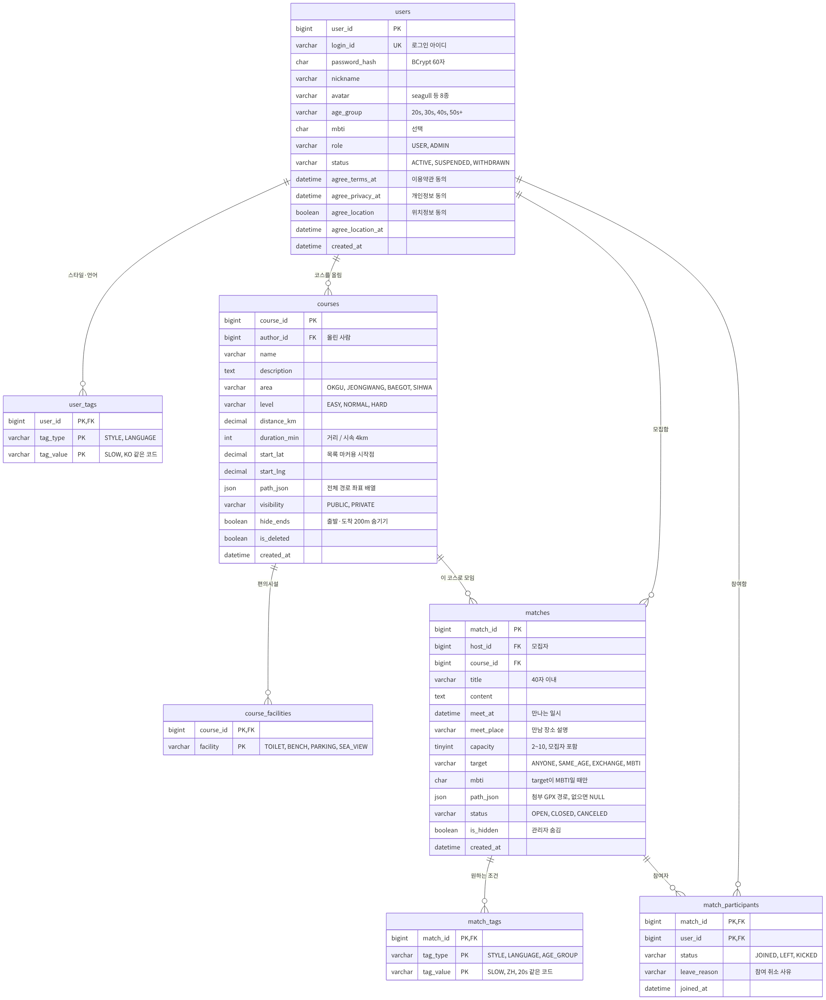

# DB 안내 (MySQL)

[← README](../README.md) · [세팅 가이드](../docs/setup.md) · [개발 규칙](../docs/development.md) · [막혔을 때](../docs/troubleshooting.md)

1주차(계정 · 코스 · 동행)에 쓰는 **테이블 7개**와 동행 상태를 계산하는 **뷰 1개**가 있습니다.
2주차 테이블(후기 · 신고 · 랜드마크 · 스탬프 · 댓글)은 2주차 시작 전에 추가합니다.

| 파일 | 내용 |
| --- | --- |
| `schema.sql` | 테이블 만들기. **실행하면 기존 테이블과 데이터가 전부 지워지고 새로 만들어집니다** |
| `seed.sql` | 테스트 데이터 (회원 7명, 코스 4개, 동행 6개). `schema.sql` 다음에 실행 |
| `check.sql` | 세팅 확인. 5줄 모두 `OK`면 성공 |

## 목차

- [ERD (테이블 관계도)](#erd-테이블-관계도)
- [테이블 한눈에 보기](#테이블-한눈에-보기)
- [설계 약속 (꼭 읽기)](#설계-약속-꼭-읽기)
- [처음 세팅 (윈도우, 한 번만)](#처음-세팅-윈도우-한-번만)
- [테스트 계정과 샘플 데이터](#테스트-계정과-샘플-데이터)
- [1주차 쿼리 예시](#1주차-쿼리-예시)
- [테이블을 바꾸고 싶을 때](#테이블을-바꾸고-싶을-때)
- [막혔을 때](#막혔을-때)
- [부록: 맥](#부록-맥)

---

## ERD (테이블 관계도)



- 깃허브에서 **그림을 누르면 크게** 볼 수 있습니다.
- **선 읽는 법:** `||` 쪽이 1, `o{` 쪽이 0개 이상(N). 예) 회원 1명이 코스를 0개 이상 올림 (1 : N)
- 그림에 없는 것: **`v_match_status` 뷰**. `matches` + `match_participants`로 동행의 현재 인원과 화면 상태(OPEN/FULL/CLOSED/CANCELED/DONE)를 계산합니다.
- 모든 테이블에 `created_at`, `updated_at`이 있습니다 (그림에서는 일부 생략).
- 그림 원본은 [`docs/images/erd.mmd`](../docs/images/erd.mmd)입니다. 테이블이 바뀌면 원본을 고치고 [mermaid.live](https://mermaid.live)에 붙여 넣어 PNG로 다시 저장합니다 (민서).

---

## 테이블 한눈에 보기

| 테이블 | 담당 | 한 줄에 담기는 것 | 메모 |
| --- | --- | --- | --- |
| `users` | 정란 | 회원 1명 | 탈퇴해도 지우지 않음 (`status = 'WITHDRAWN'`) |
| `user_tags` | 정란 | 회원의 스타일 또는 언어 1개 | 언어가 2개면 2줄 |
| `courses` | 동언 | 코스 1개 | 경로는 `path_json` 한 칸에 통째로 |
| `course_facilities` | 동언 | 코스의 편의시설 1개 | 있음/없음만 (개수 없음) |
| `matches` | 민서 | 동행 모집 글 1개 | `status`에는 OPEN · CLOSED · CANCELED만 저장 |
| `match_tags` | 민서 | 동행이 원하는 스타일 · 언어 · 연령대 1개 | |
| `match_participants` | 민서 | 동행 참여자 1명 | 모집자도 한 줄 들어감 |
| `v_match_status` (뷰) | 민서 | 동행 1개의 현재 인원 · 화면 상태 | FULL, DONE은 여기서 계산 |

---

## 설계 약속 (꼭 읽기)

### 1. 이름과 값

- **DB는 `snake_case`, JSON은 `camelCase`**: `age_group` ↔ `ageGroup`, `distance_km` ↔ `distanceKm`
- 코드값은 **API 명세의 "값 약속"과 똑같은 영어 코드**입니다 (`OKGU`, `EASY`, `EXCHANGE`, `SLOW`, `KO`, `20s` …).
- **화면에 보이는 글자(이모지 포함)는 DB에 저장하지 않습니다.** DB와 API는 코드만 주고받고, 프론트가 코드에 맞는 문구를 붙여 보여 줍니다. 그래서 피그마 문구를 바꿔도 DB는 그대로입니다.
- 약속에 없는 값을 넣으면 DB가 막습니다: `Check constraint 'chk_…' is violated`. 서블릿에서 먼저 검사해서 `400 INVALID_INPUT`으로 돌려주세요.

**회원가입(A4) · 동행 모집에서 고르는 값** (피그마 A4 칩 기준)

| 종류 | 코드 → 화면 문구 |
| --- | --- |
| 연령대 `age_group` / `AGE_GROUP` | `20s` 20대, `30s` 30대, `40s` 40대, `50s+` 50대 이상 |
| 산책 스타일 `STYLE` (최대 3개) | `SLOW` 🐢 천천히, `FAST` 🏃 빠르게, `QUIET` 🤫 조용히, `CHAT` 💬 수다, `PHOTO` 📸 사진 찍으며, `SUNRISE_SUNSET` 🌅 일출 · 일몰, `DOG` 🐶 반려견과 |
| 언어 `LANGUAGE` | `KO` 한국어, `ZH` 中文, `EN` English, `VI` Tiếng Việt, `RU` Русский |
| MBTI `mbti` | `ENFP` 같은 4글자, 선택 안 함이면 `NULL` |

### 2. 여러 개 고르는 값은 태그 테이블

스타일 · 언어 · 연령대 · 편의시설처럼 여러 개를 고르는 값은 **값 하나당 한 줄**입니다.

- 저장: 그 회원(동행, 코스)의 태그를 **전부 지우고 다시 넣기**가 가장 간단합니다.
  `DELETE FROM user_tags WHERE user_id = ? AND tag_type = 'STYLE'` → 고른 개수만큼 `INSERT`
- 필터 ("中文(`ZH`) 가능한 동행만"): `EXISTS`로 찾습니다 → [쿼리 예시](#1주차-쿼리-예시)
- 응답에서 배열로 만들 때: `GROUP_CONCAT(tag_value)` 결과를 쉼표로 나누거나, 태그만 따로 조회해서 자바에서 `List`로 묶기

### 3. 지우지 않습니다

| 대상 | 지울 때 | 목록 · 상세 쿼리에 꼭 넣을 조건 |
| --- | --- | --- |
| 회원 탈퇴 | `users.status = 'WITHDRAWN'` | 작성자 이름을 "탈퇴한 회원"으로 표시 |
| 코스 삭제 | `courses.is_deleted = TRUE` | `is_deleted = FALSE` (+ 남의 `PRIVATE` 코스 제외) |
| 동행 모집 취소 | `matches.status = 'CANCELED'` | 목록 기본값은 모집 중(`OPEN`)만 |
| 관리자가 동행 숨김 | `matches.is_hidden = TRUE` | `is_hidden = FALSE` (상세는 404) |

다른 테이블이 참조하는 행을 `DELETE`하면 `ERROR 1451`이 납니다. 정상입니다. 상태를 바꾸세요.

### 4. 저장하지 않고 계산하는 값

| API 응답 값 | 계산 방법 |
| --- | --- |
| 동행 `current`, `status` | **`v_match_status` 뷰**에서 꺼내기. 우선순위: CANCELED > DONE(일시 지남) > CLOSED > FULL(정원 참) > OPEN |
| 참여자 `isHost` | `match_participants.user_id = matches.host_id` |
| `matchCount` (모임 횟수) | 상태가 DONE인 동행 중 내가 `JOINED`인 것의 개수 |
| `timeSlot` (시간대) | `HOUR(meet_at)`: 6~11 MORNING, 12~17 AFTERNOON, 18~23 EVENING |
| 동행 `meetPoint` | 첨부 경로(`matches.path_json`)의 첫 점, 없으면 코스 시작점(`start_lat`, `start_lng`) |
| 동행 `hasGpx` | `matches.path_json IS NOT NULL` |
| 동행 `path` | 첨부 경로가 있으면 그것, 없으면 코스의 `path_json` |
| 코스 `rating`, `reviewCount` | **1주차에는 `0`으로 응답.** 후기 테이블이 생기는 2주차에 계산 |
| 코스 상세 `landmarks` | **1주차에는 빈 배열 `[]`.** 랜드마크 테이블은 2주차 |

`durationMin`(코스 예상 시간)만 예외로, 코스를 등록할 때 `거리 ÷ 시속 4km`로 계산해서 저장합니다.

### 5. 경로와 GPX

- **GPX 파일은 서버에 저장하지 않습니다.** 업로드된 GPX에서 좌표만 뽑아 `path_json`에 `[[위도, 경도], …]` 형태로 저장합니다.
- GPX 다운로드는 `path_json`으로 GPX를 **그때 만들어서** 보냅니다. "출발·도착 200m 숨기기"(`hide_ends`)가 켜져 있으면 앞뒤를 잘라서 보냅니다.
- 그래서 업로드 폴더를 관리할 필요가 없고, 파일이 없는 샘플 코스도 다운로드가 됩니다.

### 6. 비밀번호

- `password_hash`에는 **BCrypt 해시(60자)** 만 저장합니다. 원문 저장 금지.
- 테스트 계정 해시는 `$2a$10$…` 형식이라 자바 BCrypt 라이브러리(jBCrypt 등)로 바로 검사할 수 있습니다.

### 7. 참여하기는 트랜잭션으로

두 명이 동시에 마지막 자리를 누를 수 있습니다. **`FOR UPDATE`로 모집 글을 잠근 다음** 인원을 세고 넣습니다. → [쿼리 예시](#1주차-쿼리-예시)

### 8. 날짜

- `DATETIME`에 **한국 시간 그대로** 저장합니다. API 형식은 `"2026-11-02T10:00:00"`.
- 배포할 때 DB 서버 시간대를 한국 시간으로 맞춰야 DONE 판단이 맞습니다 (배포 단계에서 처리).

---

## 처음 세팅 (윈도우, 한 번만)

> **누가:** 1주차에는 **백엔드 3명(민서 · 정란 · 동언)** 이 꼭 해야 합니다.
> 프론트 2명(동훈 · 승민)은 2주차에 실제 API로 같이 테스트할 때 하면 됩니다. 그 전에는 가짜 데이터(mock)로 개발합니다.

### 1) MySQL 8.4 설치

| 단계 | 할 일 |
| --- | --- |
| 1 | [dev.mysql.com/downloads/mysql](https://dev.mysql.com/downloads/mysql/) → 버전 **8.4.x LTS** → OS **Microsoft Windows** → **Windows (x86, 64-bit), MSI Installer** → Download → 아래쪽 **"No thanks, just start my download."** |
| 2 | 받은 `.msi` 실행 → **Typical** 설치 → 마지막에 **MySQL Configurator 실행**을 선택 |
| 3 | Configurator **Type and Networking**: Config Type **Development Computer**, Port **3306** 그대로 |
| 4 | **Accounts and Roles**: root 비밀번호 정하기. **본인 PC 관리용이라 본인만 알면 됩니다.** 잊지 않게 적어 두세요 |
| 5 | **Windows Service**: 체크된 그대로 (서비스 이름 `MySQL84`, 컴퓨터 켤 때 자동 시작) |
| 6 | **Sample Databases**: 체크하지 않음 → **Execute** → **Finish** |

> 💡 수업 때 **MySQL 8.0을 이미 깔았다면** 새로 깔지 말고 그대로 쓰세요. 2)부터 하면 됩니다. (명령의 `8.4`를 `8.0`으로 바꿔서)

### 2) DB와 팀 계정 만들기 (root로, 한 번만)

**명령 프롬프트(cmd)** 를 열고:

```bat
"C:\Program Files\MySQL\MySQL Server 8.4\bin\mysql.exe" -u root -p
```

root 비밀번호를 넣고 `mysql>`이 나오면 아래 세 줄을 붙여 넣습니다.
**`디스코드_공지_비밀번호` 자리에 디스코드에 공지된 팀 비밀번호**를 넣으세요.

```sql
CREATE DATABASE sanchaek DEFAULT CHARACTER SET utf8mb4 COLLATE utf8mb4_0900_ai_ci;
CREATE USER 'sanchaek'@'localhost' IDENTIFIED BY '디스코드_공지_비밀번호';
GRANT ALL PRIVILEGES ON sanchaek.* TO 'sanchaek'@'localhost';
```

`exit`로 나옵니다. 다섯 명 모두 아래 값이 같아야 백엔드 설정 파일을 같이 쓸 수 있습니다.

| 항목 | 값 |
| --- | --- |
| 주소 | `localhost:3306` |
| DB 이름 | `sanchaek` |
| 계정 | `sanchaek` |
| 비밀번호 | 디스코드 공지 (**깃허브에 절대 올리지 않음**) |

### 3) 테이블과 테스트 데이터 넣기 (테이블이 바뀔 때마다 다시)

```bat
"C:\Program Files\MySQL\MySQL Server 8.4\bin\mysql.exe" -u sanchaek -p
```

팀 비밀번호를 넣고 `mysql>`에서:

```sql
source C:/dev/jspTeam/Team_walk/db/schema.sql
source C:/dev/jspTeam/Team_walk/db/seed.sql
```

> ⚠️ **한 줄에 `source` 하나씩** 입력합니다 (두 줄을 한 번에 붙여 넣어도 됩니다).
> 경로는 역슬래시(`\`)가 아니라 **슬래시(`/`)** 로 씁니다. 저장소를 다른 곳에 받았다면 경로만 바꾸세요.

### 4) 확인

같은 `mysql>`에서:

```sql
source C:/dev/jspTeam/Team_walk/db/check.sql
```

아래처럼 **5줄 모두 `OK`** 면 성공입니다. **캡처해서 디스코드에 올려 주세요.**

```
+----------------------------------------------------+--------+
| check_item                                         | result |
+----------------------------------------------------+--------+
| tables 7 + view 1                                  | OK     |
| seed rows (users 7, courses 4, matches 6)          | OK     |
| match status (OPEN,OPEN,FULL,CLOSED,CANCELED,DONE) | OK     |
| korean / chinese text saved                        | OK     |
| database charset utf8mb4                           | OK     |
+----------------------------------------------------+--------+
```

> 💡 동행 날짜는 `seed.sql`을 **실행한 날** 기준입니다. 실행하고 5일쯤 지나면 1번 동행도 날짜가 지나 `match status`가 `FAIL`로 바뀝니다. 그때는 3)을 다시 실행하세요.

직접 눈으로 보고 싶으면:

```sql
SELECT m.match_id, m.title, s.current_count, m.capacity, s.status
FROM matches m JOIN v_match_status s ON s.match_id = m.match_id;
```

### 화면으로 보고 싶다면 (선택)

- **MySQL Workbench 8.0**으로 접속하면 "서버 버전이 호환되지 않는다"는 경고가 뜹니다. **Continue Anyway**를 누르면 SQL 실행과 테이블 보기는 됩니다. 일부 관리 기능은 안 될 수 있습니다.
- 세팅과 테이블 생성은 위의 명령 프롬프트 방법을 기준으로 합니다.

---

## 테스트 계정과 샘플 데이터

**비밀번호는 전부 `test1234!`** 입니다. 로컬 테스트 전용이고, 배포 서버에는 `seed.sql`을 그대로 넣지 않습니다.

| 아이디 | 역할 | 쓰임 |
| --- | --- | --- |
| `admin` | 관리자 (`ADMIN`) | 관리자 JSP 테스트 |
| `minseo`, `jeongran`, `dongeon`, `donghun`, `seungmin` | 일반 회원 | 각자 테스트 |
| `banned` | 정지된 회원 (`SUSPENDED`) | 로그인하면 `403 SUSPENDED`가 나와야 정상 |

**동행 6개**는 날짜를 "실행한 날" 기준으로 계산해서, 언제 다시 실행해도 아래 상태가 나옵니다.

| 번호 | 화면 상태 | 이걸로 확인할 것 |
| --- | --- | --- |
| 1 | OPEN 2/4 | GPX 첨부(`hasGpx: true`), 언어 `ZH`(中文) 필터, 저녁 시간대, 내용에 中文 문장 |
| 2 | OPEN 1/6 | 승민이 내보내짐(`KICKED`) → 다시 참여하면 `403` |
| 3 | FULL 3/3 | 참여하면 `409 FULL` |
| 4 | CLOSED 2/4 | MBTI(ISFP) 모집, 참여하면 `409 CLOSED` |
| 5 | CANCELED | 모집 취소된 글 |
| 6 | DONE | 지난 동행, 동훈이 참여 취소(`LEFT`) → 민서의 모임 횟수 1 |

**코스 4개**는 지역마다 하나씩입니다 (옥구공원 · 정왕역 · 배곧생명공원 · 오이도 빨강등대). 좌표는 장소 주변을 둥글게 그린 **임시 경로**라 실제 길과 다릅니다. 2주차에 실제 GPX로 바꿀 예정입니다 (동언).

---

## 1주차 쿼리 예시

DAO를 만들 때 출발점으로 쓰세요. `?` 자리는 `PreparedStatement`로 넣습니다.

**코스 목록 (동언)**: 공개 + 삭제 안 된 것, 거리순

```sql
SELECT c.course_id, c.name, c.area, c.distance_km, c.duration_min, c.level,
       c.start_lat, c.start_lng, GROUP_CONCAT(f.facility) AS facilities
FROM courses c
LEFT JOIN course_facilities f ON f.course_id = c.course_id
WHERE c.is_deleted = FALSE AND c.visibility = 'PUBLIC'
  AND c.area = ?                 -- 필터가 있을 때만 붙이기
GROUP BY c.course_id
ORDER BY c.distance_km
LIMIT ? OFFSET ?;                -- size, (page - 1) * size
```

편의시설 `TOILET,BENCH`가 **둘 다** 있는 코스만:

```sql
AND (SELECT COUNT(*) FROM course_facilities f2
     WHERE f2.course_id = c.course_id AND f2.facility IN ('TOILET', 'BENCH')) = 2
```

**동행 목록 (민서)**: 모집 중만, 마감 임박순, 언어 필터

```sql
SELECT m.match_id, m.title, m.meet_at, m.capacity, s.current_count, s.status,
       c.course_id, c.name AS course_name, c.distance_km, c.level,
       h.user_id AS host_id, h.nickname AS host_nickname, h.avatar AS host_avatar
FROM matches m
JOIN v_match_status s ON s.match_id = m.match_id
JOIN courses c ON c.course_id = m.course_id
JOIN users h ON h.user_id = m.host_id
WHERE m.is_hidden = FALSE
  AND s.status = 'OPEN'
  AND EXISTS (SELECT 1 FROM match_tags t
              WHERE t.match_id = m.match_id AND t.tag_type = 'LANGUAGE' AND t.tag_value IN (?))
ORDER BY m.meet_at
LIMIT ? OFFSET ?;
```

**참여하기 (민서, 2주차)**: 잠그고 → 세고 → 넣기

```sql
START TRANSACTION;
SELECT capacity, status FROM matches WHERE match_id = ? FOR UPDATE;   -- 다른 사람은 여기서 기다림
SELECT current_count, status FROM v_match_status WHERE match_id = ?;  -- 자바에서 FULL/CLOSED 검사
SELECT status FROM match_participants WHERE match_id = ? AND user_id = ?;  -- KICKED면 403, JOINED면 409
INSERT INTO match_participants (match_id, user_id) VALUES (?, ?)
    ON DUPLICATE KEY UPDATE status = 'JOINED', leave_reason = NULL;   -- 취소했다가 다시 참여
COMMIT;
```

---

## 테이블을 바꾸고 싶을 때

1. **디스코드에 먼저 알립니다.** ("users에 ○○ 칸을 추가하려고 해요")
2. 브랜치를 만들어 `schema.sql`을 고치고, 필요하면 `seed.sql`도 맞춥니다.
3. PR을 올립니다. **DB 변경 PR의 리뷰어는 민서**입니다.
4. 합쳐지면 디스코드에 공지 → 모두 `git pull` 후 [3)](#3-테이블과-테스트-데이터-넣기-테이블이-바뀔-때마다-다시)를 다시 실행합니다. 데이터가 초기화되지만 개발 중에는 테스트 데이터뿐이라 괜찮습니다.

> ⚠️ **자기 PC에서만 `ALTER TABLE`로 고치지 마세요.** 내 DB에서는 되는데 다른 사람 PC에서는 오류가 나는 원인이 됩니다.

---

## 막혔을 때

| 증상 | 원인 | 해결 |
| --- | --- | --- |
| `'mysql'은(는) 내부 또는 외부 명령 … 이 아닙니다` | MySQL 경로가 PATH에 없음 | 위처럼 **전체 경로**(`"C:\Program Files\MySQL\MySQL Server 8.4\bin\mysql.exe"`)로 실행 |
| `ERROR 2003 … Can't connect to MySQL server on 'localhost:3306'` | MySQL 서비스가 꺼짐 | **Win+R → `services.msc`** → `MySQL84` 우클릭 → 시작 |
| `ERROR 1045 (28000): Access denied for user 'sanchaek'` | 비밀번호가 틀렸거나 2)를 안 함 | 디스코드 비밀번호 확인, root로 [2)](#2-db와-팀-계정-만들기-root로-한-번만) 실행 |
| `ERROR 1049 (42000): Unknown database 'sanchaek'` | DB를 안 만듦 | root로 [2)](#2-db와-팀-계정-만들기-root로-한-번만) 실행 |
| `source` 했는데 `Failed to open file` | 경로가 틀렸거나 역슬래시(`\`) 사용 | 슬래시(`/`)로, 탐색기에서 실제 경로 확인 |
| Configurator에서 3306 포트가 사용 중 | 다른 MySQL이나 XAMPP(MariaDB)가 켜져 있음 | 기존 것을 끄거나, 기존 MySQL 8.0을 그대로 사용 |
| 설치 중 Visual C++ / `VCRUNTIME` 오류 | 실행에 필요한 MS 패키지 없음 | **Microsoft Visual C++ 재배포 패키지(x64)** 설치 후 다시 |
| cmd에서 한글이 깨지거나 `?`로 보임 | 명령 프롬프트 화면 표시 문제 (저장은 정상인 경우가 많음) | `chcp 65001` 입력 후 다시 접속, 또는 Workbench로 확인 |
| `ERROR 3819: Check constraint 'chk_…' is violated` | 값 약속에 없는 값 (소문자, 오타 등) | [설계 약속 1](#1-이름과-값) 확인 |
| `ERROR 1062: Duplicate entry` | 중복 (아이디 등). 아이디는 대소문자를 구분하지 않음 | 서블릿에서 `409 DUPLICATE`로 응답 |
| `ERROR 3140: Invalid JSON text` | `path_json`에 JSON이 아닌 문자열 | Gson으로 만든 문자열을 넣기 |
| `ERROR 1451: Cannot delete or update a parent row` | 다른 테이블이 참조하는 행을 지우려 함 | 지우지 말고 상태 변경 ([설계 약속 3](#3-지우지-않습니다)) |
| 자바에서 **`Illegal mix of collations (utf8mb4_0900_ai_ci …) and (utf8mb4_unicode_ci …)`** | DB 드라이버의 글자 비교 기준이 MySQL 기본값과 다름. 뷰의 상태 값과 비교할 때 생김 (실제 테스트에서 발견) | 최신 `schema.sql`로 다시 실행 (뷰에 `COLLATE utf8mb4_0900_ai_ci`가 들어가 있어야 함). **뷰의 `COLLATE` 줄은 지우지 않기** |
| `check.sql`에서 `match status`만 `FAIL` | `seed.sql`을 실행한 지 며칠 지나 동행 날짜가 지남 | [3)](#3-테이블과-테스트-데이터-넣기-테이블이-바뀔-때마다-다시) 다시 실행 |
| `check.sql`에서 `tables`나 `seed rows`가 `FAIL` | `schema.sql`이나 `seed.sql` 실행 중 오류가 남 | 3)을 다시 실행하면서 빨간 `ERROR` 줄을 캡처해 디스코드에 |

---

## 부록: 맥

```bash
brew install mysql@8.4
brew services start mysql@8.4
/opt/homebrew/opt/mysql@8.4/bin/mysql -u root        # 처음에는 root 비밀번호 없음
```

그다음은 윈도우의 [2)](#2-db와-팀-계정-만들기-root로-한-번만)부터 같습니다. `source` 경로만 맥 경로로 씁니다.
예: `source /Users/이름/Downloads/Team_walk/db/schema.sql`
