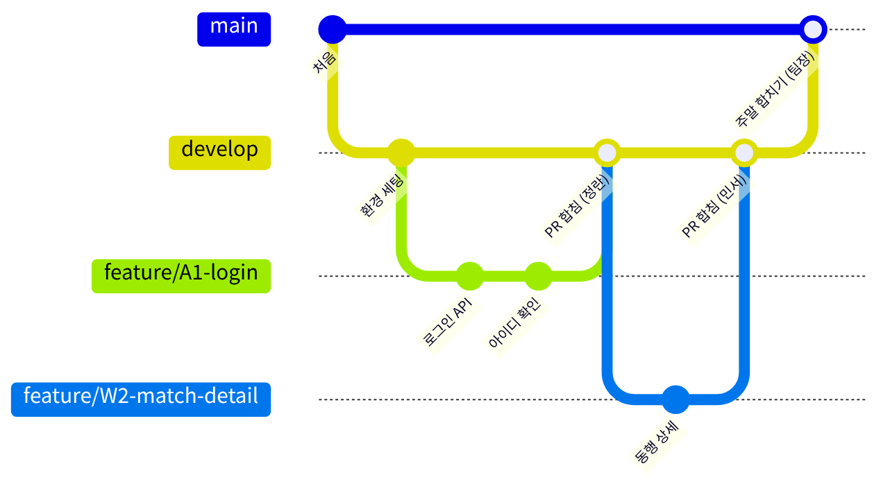
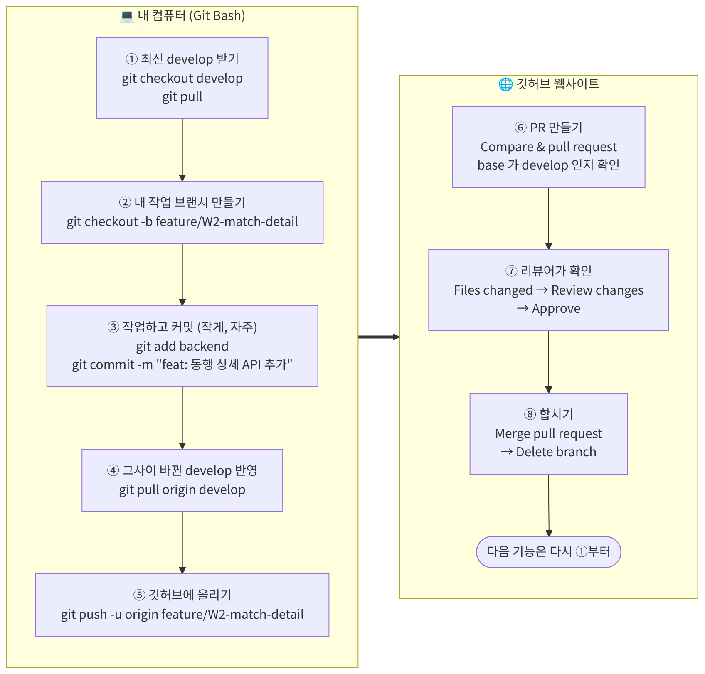

# 개발 규칙

[← README](../README.md) · [세팅 가이드](setup.md) · [DB 안내](../db/README.md) · [막혔을 때](troubleshooting.md)

작업할 때마다 보는 문서입니다.<br>
API · 화면 만드는 법, 백엔드 공통 코드, 브랜치 · PR 규칙, **깃허브 사용법**(명령어 · PR 올리기 · 리뷰 · 실수 되돌리기), 커밋 메시지가 있습니다.

## 목차

- [1. 개발 방법](#1-개발-방법)
  - [백엔드 공통 코드](#백엔드-공통-코드)
- [2. 브랜치·PR 규칙](#2-브랜치pr-규칙)
- [3. 깃허브 사용법](#3-깃허브-사용법)
  - [3-1. 처음 한 번](#3-1-처음-한-번)
  - [3-2. 기능 하나 작업할 때마다](#3-2-기능-하나-작업할-때마다)
  - [3-3. PR 올리는 법 (깃허브 화면)](#3-3-pr-올리는-법-깃허브-화면)
  - [3-4. 리뷰하고 합치는 법 (리뷰어)](#3-4-리뷰하고-합치는-법-리뷰어)
  - [3-5. 충돌이 났을 때](#3-5-충돌이-났을-때)
  - [3-6. 자주 하는 실수와 되돌리기](#3-6-자주-하는-실수와-되돌리기)
- [4. 커밋 메시지](#4-커밋-메시지)

---

## 1. 개발 방법

### 공통 원칙

1. **API 명세가 약속입니다.** 주소, 요청, 응답 모양은 API 명세를 따릅니다. 바꿔야 하면 **명세를 먼저 고치고 짝에게 알립니다.**
2. **서로 기다리지 않습니다.** 프론트는 가짜 데이터로 먼저 만들고, 백엔드는 명세대로 먼저 만듭니다.
3. **우선순위대로 합니다.** 노션의 1순위 → (시간 남으면) 2순위. 보류 항목은 하지 않습니다.

### 백엔드: API 하나 만드는 법 (스프링부트 4.1)

프로젝트 만드는 법과 폴더 구조는 [backend/README.md](../backend/README.md)에 있습니다.

| 항목 | 규칙 | 예시 |
| --- | --- | --- |
| 위치 | `kr.sanchaek.<담당 도메인>` | 동행이면 `kr.sanchaek.match` |
| 요청 처리 | `…Controller` + `@RestController`, `@GetMapping("/api/…")` | `MatchController` |
| DB 접근 | `…Repository` + `JdbcTemplate` (SQL은 직접 작성) | `MatchRepository` |
| 데이터 묶음 | `record` 또는 클래스. **필드 이름이 그대로 JSON 이름**이 되니 camelCase로 | `Match` (`meetAt`, `currentCount`) |
| 응답 | 공통 응답 `ApiResponse` (아래 표) | 아래 예시 |

- 응답 형식, 오류 JSON, 로그인 확인, 비밀번호, 파일 저장은 **공통 코드(`kr.sanchaek.common`)를 가져다 씁니다.** 각자 따로 만들지 않습니다.
- 다 만들면 브라우저나 `curl`로 호출해서 **API 명세의 응답 예시와 모양이 같은지** 확인합니다.
- 관리자 화면(AD1~AD4)도 **React**입니다 (`src/pages/admin/`). API는 `/api/admin/…`이고, 그 API를 만든 백엔드 담당이 화면도 같이 만듭니다.

### 백엔드 공통 코드

> `backend/src/main/java/kr/sanchaek/common/` 에 있습니다 (민서). **각자 따로 만들지 말고 가져다 쓰세요.**<br>
> 파일마다 맨 위 주석에 사용 예시가 있습니다.

| 하고 싶은 것 | 이렇게 씁니다 | 파일 |
| --- | --- | --- |
| DB 조회 · 저장 | `JdbcTemplate`을 생성자로 받아서 사용 | (스프링부트 기본) |
| 성공 응답 | `return ApiResponse.ok(data);` → `{ "success": true, "data": … }`<br>돌려줄 값이 없으면 `ApiResponse.ok()` → `{ "success": true }` | `ApiResponse` |
| 새로 만들기 성공 (201) | 메서드에 `@ResponseStatus(HttpStatus.CREATED)` | |
| 목록 응답 | `new PageResult<>(items, page, size, total)` → `{ "items", "page", "size", "total" }`<br>SQL `LIMIT ? OFFSET ?` 의 OFFSET은 `PageResult.offset(page, size)` | `PageResult` |
| 실패 응답 | `throw ApiException.notFound("코스를 찾을 수 없어요.");`<br>`badRequest`(400) · `forbidden`(403) · `notFound`(404) · `conflict("FULL", …)`(409)<br>그 밖의 코드는 `throw new ApiException(401, "LOGIN_FAILED", "…");` | `ApiException` |
| 오류를 JSON으로 | 자동. 없는 주소 404, `@Valid` 검사 실패 · JSON 형식 오류 400, 업로드 용량 초과 400 `TOO_LARGE`, 그 밖의 예외 500 (원인은 서버 로그에) | `ApiExceptionHandler` |
| 로그인한 사람 번호 | 파라미터에 `@LoginUser Long userId` → 로그인 안 했으면 **자동으로 401**<br>로그인 선택 API는 `@LoginUser(required = false) Long userId` (안 했으면 `null`)<br>파라미터 **맨 앞**에 두기 (그래야 입력값 검사 400보다 로그인 확인 401이 먼저) | `LoginUser` |
| 관리자 API | 주소를 `/api/admin/…`로 만들면 자동 검사 (로그인 안 함 401, 관리자 아님 403) | `AdminInterceptor` |
| 로그인 · 로그아웃 (정란) | `SessionUtil.login(request, userId, role)` · `SessionUtil.logout(request)`<br>컨트롤러 파라미터에 `HttpServletRequest request` 를 받아서 사용 | `SessionUtil` |
| 비밀번호 (정란) | `BCryptPasswordEncoder` — `build.gradle`에 `spring-security-crypto` 한 줄 추가 후 사용 ([backend/README.md](../backend/README.md#라이브러리-buildgradle)). **SQL로 비교하지 않기** | 로그인 만들 때 |
| 사진 · GPX 저장 | `fileStore.save(file, "reviews/88-1.jpg")` → DB에는 이 경로만 저장<br>응답 주소는 `FileStore.url(path)` → `"/files/reviews/88-1.jpg"` (이 주소로 파일이 열림) | `FileStore` |
| GPX 다운로드 | `return fileStore.download(gpxPath, "코스이름.gpx");` (파일 없으면 404) | `FileStore` |
| GPX 읽기 | `GpxParser.parse(file)` → `[위도, 경도]` 목록, `GpxParser.toJson(points)` → `path_json`에 넣을 문자열. 형식이 틀리면 400 `INVALID_FORMAT` | `GpxParser` |

**로그인한 상태로 시험해 보기 (개발용 로그인)**

정란의 로그인 API가 나오기 전에도 "로그인 필요" API를 시험할 수 있게 개발용 로그인을 만들어 두었습니다.

1. `application-local.properties`에 `app.dev-login=true` 한 줄 추가 → 서버 다시 켜기
2. 브라우저에서 `localhost:8080/api/dev/login?userId=2` (seed 회원 번호: 1 admin, 2 민서, 3 정란, 4 동언, 5 동훈, 6 승민)
3. 같은 브라우저에서 API 주소를 열면 그 회원으로 로그인한 상태입니다. 끝낼 때는 `/api/dev/logout`

- POST · PUT · DELETE는 브라우저 주소창으로 못 부르니 터미널의 `curl`을 씁니다. 예시는 [`backend/scripts/match-api-test.sh`](../backend/scripts/match-api-test.sh) (동행 API 전체를 차례로 불러 보는 스크립트).
- `app.dev-login`이 없거나 `false`면 이 주소는 404입니다.


**예시: 동행 상세 `GET /api/matches/3`** (모양 참고용. 공통 코드를 그대로 쓰는 예시)

```java
@RestController
public class MatchController {
    private final MatchRepository repo;

    public MatchController(MatchRepository repo) {   // 스프링이 알아서 넣어 줌
        this.repo = repo;
    }

    @GetMapping("/api/matches/{id}")
    public ApiResponse<Match> detail(@PathVariable long id) {
        Match match = repo.findById(id);
        if (match == null) {
            throw ApiException.notFound("모집 글을 찾을 수 없어요.");
        }
        return ApiResponse.ok(match);
    }

    @PostMapping("/api/matches/{id}/join")              // 로그인 "필요" API
    public ApiResponse<Void> join(@PathVariable long id, @LoginUser Long userId) {
        // 여기까지 왔으면 userId 는 항상 있음 (로그인 안 했으면 이미 401)
        repo.join(id, userId);
        return ApiResponse.ok();
    }
}
```

```java
@Repository
public class MatchRepository {
    private final JdbcTemplate jdbc;

    public MatchRepository(JdbcTemplate jdbc) {
        this.jdbc = jdbc;
    }

    public Match findById(long matchId) {
        String sql = "SELECT m.match_id, m.title, m.meet_at, s.status, s.current_count "
                   + "FROM matches m JOIN v_match_status s ON s.match_id = m.match_id WHERE m.match_id = ?";
        List<Match> rows = jdbc.query(sql, (rs, i) -> new Match(
                rs.getLong("match_id"),
                rs.getString("title"),
                rs.getObject("meet_at", LocalDateTime.class),   // → "2026-11-02T19:00:00"
                rs.getString("status"),
                rs.getInt("current_count")), matchId);
        return rows.isEmpty() ? null : rows.get(0);
    }
}

public record Match(long matchId, String title, LocalDateTime meetAt, String status, int currentCount) {}
```

- 날짜는 **`LocalDateTime`** 으로 담으면 명세 형식(`"2026-11-02T19:00:00"`)으로 나갑니다. `String`으로 담지 마세요.
- SQL에 값을 넣을 때는 항상 `?` + `jdbc.query(sql, …, 값)` (문자열 더하기 금지).
- 쿼리 예시는 [DB 안내의 쿼리 예시](../db/README.md#쿼리-예시)에 담당자별로 있습니다.

### 프론트: 화면 하나 만드는 법

| 폴더 | 넣는 것 | 예시 |
| --- | --- | --- |
| `src/pages/` | 화면 하나 = 파일 하나. **Figma 화면 ID**를 이름 앞에 | `W1MatchList.jsx`, `C2CourseDetail.jsx` |
| `src/components/` | 여러 화면이 같이 쓰는 부품 | `Header.jsx`, `CourseCard.jsx`, `KakaoMap.jsx` |
| `src/api/` | 백엔드 호출 함수 (도메인별 한 파일) | `matchApi.js`의 `getMatches()` |
| `src/mocks/` | 백엔드 완성 전 가짜 데이터 (API 명세의 응답 예시 복사) | `matches.json` |

1. 백엔드가 아직이면 `src/api/`의 함수가 `src/mocks/`의 가짜 데이터를 돌려주게 만들고 화면부터 완성
2. 백엔드 API가 develop에 합쳐지면 **`src/api/`의 함수만** 실제 `fetch('/api/…')`로 교체 (화면 코드는 그대로)
3. 공통 부품은 담당자(동훈: 지도·헤더·카드 / 승민: 버튼·입력창·모달)가 만들고 서로 가져다 씀

- 백엔드 응답은 항상 `{ success, data }` 또는 `{ success: false, error: { code, message } }` 입니다. 오류도 JSON이라 `res.json()`으로 읽고 `error.message`를 토스트로 보여 주면 됩니다.
- 후기 사진은 응답의 주소(`/files/reviews/1-1.jpg`)를 ``에 그대로 넣습니다. Vite가 백엔드(8080)로 넘겨 줍니다.

### 같이 테스트하는 법

1. 백엔드 실행 (스프링부트, 8080)
2. `frontend`에서 `npm run dev` (5173)
3. 브라우저는 항상 **`localhost:5173`** 으로 접속

### DB

자세한 내용은 **[db/README.md](../db/README.md)** 에 있습니다. 여기서는 핵심만 적습니다.

- 1주차 테이블 7개(회원 · 코스 · 동행), 2주차 테이블 6개(후기 · 신고 · 랜드마크 · 스탬프 · 댓글), 계산용 뷰 2개(동행 상태, 코스 별점)가 있습니다. DB는 각자 PC의 MySQL입니다.
- **세팅:** MySQL 8.4 설치 → DB `sanchaek`, 계정 `sanchaek` 만들기 (비밀번호는 각자 정함) → `schema.sql` → `seed.sql` 실행 → `check.sql`로 확인 (7줄 모두 OK).<br>
  후기 사진 · GPX를 다룰 때는 `C:\dev\jspTeam\uploads` 폴더도 만듭니다.
- **테스트 계정:** `admin`, `minseo`, `jeongran`, `dongeon`, `donghun`, `seungmin`, 정지 테스트용 `banned` (비밀번호 전부 `test1234!`)
- **꼭 지킬 약속:** 지우지 않고 상태를 바꾸기 (후기만 예외), 동행 인원 · 상태는 `v_match_status`, 별점은 `v_course_rating` 뷰에서 꺼내기, GPX · 사진 파일은 업로드 폴더에 두고 DB엔 경로만 → [설계 약속](../db/README.md#설계-약속-꼭-읽기)
- **테이블을 바꿀 때:** 팀에 먼저 알리고 → `schema.sql` 수정 → PR(리뷰어 민서) → 합쳐지면 모두 `schema.sql` · `seed.sql` 다시 실행. 자기 PC에서만 `ALTER TABLE` 하지 않기.

---

## 2. 브랜치·PR 규칙



- **feature 브랜치**(초록·파랑)에서 작업하고, PR로 **develop**(노랑)에 합칩니다.
- 팀장이 주말(주차 마감)과 제출 · 발표 전에 develop을 **main**(진한 파랑)에 합칩니다.

| 브랜치 | 규칙 |
| --- | --- |
| `main` | 제출·발표용. **직접 push 금지.** 팀장이 develop → main PR로만 병합 (주차 마감, 제출·발표 전) |
| `develop` | 통합 브랜치. **직접 push 금지.** feature 브랜치의 PR로만 합침 |
| `feature/화면ID-기능` | **기능 하나마다 develop에서 새로 만들고, 합치면 삭제.** 예: `feature/A1-login`, `feature/C1-course-map` |

### PR(Pull Request) 규칙

- **대상(base)은 항상 `develop`** (main 아님)
- **리뷰어:** 백엔드 PR은 **다른 백엔드 1명**, 프론트 PR은 **다른 프론트 1명**이 확인 후 합침
- 하루 넘게 리뷰가 안 되면 팀장이 확인
- 합친 뒤 **Delete branch** 버튼으로 feature 브랜치 삭제 (코드는 develop에 남아 있으니 지워도 안전)

### PR 올리기 전 체크리스트

- [ ] 내 컴퓨터에서 실행해 봤다 (백엔드: 해당 API 호출 / 프론트: 화면 확인 + `npm run lint`)
- [ ] 최신 develop을 반영했다 (`git pull origin develop`)
- [ ] 올라갈 파일을 확인했다 (`git add --dry-run <폴더>`): `node_modules`, `build`, `.gradle`, 비밀번호가 든 설정 파일이 **없어야 함**
- [ ] 자기 담당 폴더만 고쳤다 (공용 파일을 고쳤으면 팀에 알렸다)
- [ ] 비밀번호·API 키가 들어가지 않았다

---

## 3. 깃허브 사용법

명령어는 모두 **Git Bash**에서 입력합니다. 전체 흐름은 이렇습니다.



### 3-1. 처음 한 번

저장소 받기(`git clone`)는 [세팅 가이드 2번](setup.md#2-저장소-받기와-폴더-배치)에 있습니다. 그다음 커밋에 남을 이름과 이메일을 정합니다.

```bash
git config --global user.name "김민서"
git config --global user.email "깃허브에_가입한_이메일@example.com"
git config --global --list        # 확인
```

- 이메일은 **깃허브에 가입한 이메일**과 같아야 깃허브에서 커밋한 사람이 내 계정으로 보입니다.
- 처음 `git push`를 하면 깃허브 로그인 창이 뜹니다 → **Sign in with your browser** → 로그인하면 다음부터는 안 물어봅니다.

### 3-2. 기능 하나 작업할 때마다

> ⚠️ **새 브랜치를 만들기 전에, 내가 올린 이전 PR이 develop에 합쳐졌는지 먼저 확인하세요.**
> 안 합쳐진 상태에서 develop 기반으로 새 브랜치를 만들면, 이전 PR의 파일이 작업 폴더에서 **사라진 것처럼** 보입니다. (지워진 게 아니라 아직 develop에 없는 것. 실제로 겪은 문제)

```bash
# ① 최신 develop 받기
git checkout develop
git pull

# ② 내 작업 브랜치 만들기
git checkout -b feature/W2-match-detail

# ③ 작업 … (작게, 자주 커밋)
git status                       # 바뀐 파일 보기
git add --dry-run backend        # 올라갈 파일 미리 확인 (프론트면 frontend)
git add backend
git commit -m "feat: 동행 상세 API 추가"

# ④ PR 올리기 전에 그사이 바뀐 develop 반영
git pull origin develop

# ⑤ 깃허브에 올리기
git push -u origin feature/W2-match-detail
```

- `git checkout <브랜치>`는 브랜치를 옮겨 다니는 명령입니다. 지금 어느 브랜치인지는 `git status` 첫 줄(`On branch …`)에 나옵니다.
- 두 번째 push부터는 `git push`만 입력해도 됩니다.

### 3-3. PR 올리는 법 (깃허브 화면)

1. push 후 [저장소 페이지](https://github.com/AnemoneCoronaria/Team_walk)에 노란 띠의 **Compare & pull request** 버튼 클릭
   (안 보이면 **Pull requests** 탭 → **New pull request** → compare에 내 브랜치 선택)
2. 위쪽이 **`base: develop` ← `compare: feature/…`** 인지 확인 (**main이면 안 됨**)
3. **제목:** 커밋 메시지 규칙대로 (예: `feat: 동행 상세 API 추가`)
4. **내용:** 무엇을 했나 / 어떻게 확인했나 (화면 캡처, 응답 JSON) / 리뷰어가 봐 줬으면 하는 것
5. 오른쪽 **Reviewers** 옆 ⚙ → 리뷰어 선택 (백엔드는 다른 백엔드 1명, 프론트는 다른 프론트 1명)
6. **Create pull request** → 팀 채팅방에 PR 링크 올리기
7. 리뷰에서 고칠 게 나오면: **같은 브랜치에서** 고치고 commit → `git push`. PR에 자동으로 추가됩니다 (PR을 새로 만들지 않음)

### 3-4. 리뷰하고 합치는 법 (리뷰어)

1. PR 페이지 → **Files changed** 탭에서 바뀐 내용 확인. 궁금한 줄은 줄 번호 옆 **+** 를 눌러 코멘트
2. 직접 실행해 보고 싶으면 내 컴퓨터에서:
   ```bash
   git fetch
   git checkout feature/W2-match-detail     # PR 위쪽에 적힌 브랜치 이름
   # 확인이 끝나면 내 브랜치로 돌아가기: git checkout <내 브랜치>
   ```
3. 오른쪽 위 **Review changes** → 괜찮으면 **Approve**, 고칠 게 있으면 **Request changes** + 이유 → **Submit review**
4. Approve 했으면 **Conversation** 탭 맨 아래 **Merge pull request** → **Confirm merge**
5. **Delete branch** 버튼 누르기 → 팀 채팅방에 "PR #번호 합침" 한 줄
6. 합쳐진 뒤에는 **모두** `git checkout develop` → `git pull` 로 최신을 받고 다음 작업을 시작합니다

### 3-5. 충돌이 났을 때

`git pull origin develop` 에서 `CONFLICT` 가 나오거나, PR에 **This branch has conflicts** 가 보이면:

1. `git status` → 빨간색 `both modified` 파일 확인
2. 파일을 열면 이런 표시가 있습니다:
   ```
   <<<<<<< HEAD
   내가 고친 내용
   =======
   develop에 먼저 들어간 내용
   >>>>>>> …
   ```
3. 둘 중 맞는 내용(또는 둘 다)만 남기고 `<<<<<<<`, `=======`, `>>>>>>>` 줄을 지움
4. `git add <파일>` → `git commit` → 다시 실행해서 확인 → `git push` (PR이 자동으로 갱신됨)
5. **남의 코드라서 판단이 안 서면 혼자 고치지 말고** 그 파일 담당자나 팀장에게 물어보기

> `package-lock.json` 충돌은 develop 쪽 내용을 받은 뒤 `npm install` 을 다시 하면 대부분 해결됩니다.

### 3-6. 자주 하는 실수와 되돌리기

| 상황 | 해결 |
| --- | --- |
| develop에서 바로 작업했다 (**커밋 전**) | `git checkout -b feature/…` → 고친 내용이 새 브랜치로 그대로 따라옵니다 |
| develop에서 **커밋까지** 했다 (push 전) | ① `git branch feature/…` (지금 커밋을 새 브랜치에 남김) ② `git reset --hard origin/develop` (develop은 원래대로) ③ `git checkout feature/…` |
| 커밋 메시지를 잘못 썼다 (push 전) | `git commit --amend -m "고친 메시지"` |
| 올리면 안 되는 파일을 `add` 했다 (커밋 전) | `git restore --staged <파일>` |
| push 했더니 `rejected` / `fetch first` | 깃허브의 내 브랜치가 더 최신이라는 뜻 → `git pull origin <내 브랜치>` 후 다시 `git push` |
| 실수로 **main · develop에 push** 했다 | 직접 고치려 하지 말고 **팀장에게 바로** 알리기 (팀장이 되돌림) |
| 비밀번호 · 키를 **커밋**했다 | push 전: `git reset --soft HEAD~1` → 파일에서 지우고 다시 커밋. **push 했으면** 팀장에게 알리고 비밀번호 · 키를 새로 바꾸기 (기록에 남음) |
| 다른 사람 작업이 내 컴퓨터에 안 보인다 | 그 PR이 합쳐졌는지 확인 → `git checkout develop` → `git pull` |

---

## 4. 커밋 메시지

| 머리말 | 언제 | 예시 |
| --- | --- | --- |
| `feat:` | 기능 추가 | `feat: 코스 목록 API 추가` |
| `fix:` | 버그 수정 | `fix: 로그인 한글 깨짐 수정` |
| `docs:` | 문서 | `docs: API 명세 수정` |
| `style:` | 화면·코드 모양만 변경 | `style: 버튼 간격 조정` |
| `refactor:` | 동작은 같고 구조만 개선 | `refactor: DB 연결 코드 정리` |
| `chore:` | 설정, 폴더 등 기타 | `chore: .gitignore 추가` |
